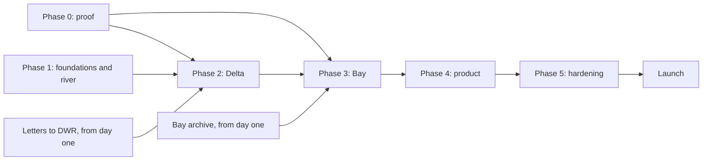

# Fischer Delta Model Returns: Build Plan

Draft for discussion · 24 November 2026 · Builds the [specification, version 1.0](specification.md)

Nothing has been built yet. This plan says what will be built, in what order, how we will know each step is done, and what has to be decided or done by people before code starts.

## 1. How the build runs

- **Six phases, 0 to 5**, as in section 10 of the specification. Each ends in something that can be seen working, and a short review with you before the next one starts.
- **Risks first.** Phase 0 proves the things that could sink the project, such as DSM2, the data feeds and NOAA's grid, before effort goes into the parts we know we can build.
- **Seams first.** The module structure, its interfaces and the checks that enforce them (specification section 4.3) exist before any model code. Every later piece is written into a slot that is already there.
- **Two regions from the start.** The plain test region (specification section 4.1) runs in the tests from the first river code, so nothing Delta-specific leaks into the engine.
- **Small, reviewable changes.** Work lands as small pull requests, one module or one feature at a time, each with its tests. Nothing merges with a failing test or a broken dependency rule.
- **One machine.** Everything server-side runs on the `webserver` host and nothing else, ever. Every other machine runs Electric Eel and is never touched. On the shared host, this app always gives way to Electric Eel.
- **Things that take calendar time start on day one.** The Bay archive and the letters to DWR do not wait for their phase.

## 2. Decisions before building

| # | Decision | Status | Choice and why |
| --- | --- | --- | --- |
| 1 | Language for the math library and compute engine | **Decided: Rust** | The only option where the math is written once and runs everywhere it is needed. It compiles to WebAssembly for the compute engine in the browser, natively for a compute engine on a server, and as a module the Python model runner calls. Strict types suit versioned interfaces. It also leaves room for 2D meshes, 3D and bioaccumulation. |
| 2 | Language for the model runner, adapters and publisher | **Decided: Python**, calling the Rust math through bindings | Python has the tools for this data: NetCDF for NOAA's files, and DWR's own Python tools for DSM2's DSS files (to confirm). The runner fetches, schedules and publishes; all its math comes from the Rust library. |
| 3 | UI stack | Recommended: TypeScript, MapLibre and Svelte | The browser needs TypeScript or JavaScript for the UI. Particles are drawn by our own graphics layer inside MapLibre; Svelte handles controls, forms, legend, timeline and graphs. Because the UI only displays, a framework change later touches only the UI. |
| 4 | Repository layout | Recommended: one repository, one package per module | `math/`, `format/`, `compute/` and `plugins/` in Rust; `runner/` and `adapters/` in Python; `ui/` in TypeScript; `regions/` and `text/` as data. Seams enforced by tooling in each language: the Rust compiler, a Python import checker and a TypeScript dependency checker. The build fails on a forbidden import. |
| 5 | Continuous integration | Recommended: GitHub Actions | Free for this public repository. Every change runs the Rust tests and WebAssembly build, the Python tests, the UI tests against recorded compute output, the dependency checks and the plug-in conformance tests. The running app never depends on GitHub. |
| 6 | How finished files reach the web edge | Path decided: `/fischer-delta/`. Waiting on your OK for the web-edge change | Served at `tripofisch.com/fischer-delta/` from `/srv/fdmr` on the existing web edge (container 703), through a Caddy route like Lux's `/play/`: no new hostname, no tunnel change. rsync over SSH from the model runner, with a key that can write only into that folder; each cycle goes into a new folder and one link switch makes it live. |

## 3. Things only people can do

You do these. Only one letter is needed for the build, and it starts now because replies take weeks.

| Task | Why | Needed by |
| --- | --- | --- |
| Email DWR's Delta Modeling Section for two things: the Linux library DSM2 needs, and the channel geometry files. If they have it, a note on how they represent levee breaches | DSM2 on Debian, the Delta map layer, the breach what-ifs | Phase 0 answers; Phase 2 at the latest |
| Approve the model runner container on the `webserver` host, the only machine this app may use | Phase 0 needs somewhere to run DSM2 | Phase 0 |
| A Windows license, only if the Linux build of DSM2 stalls and a temporary Windows VM is needed | DWR's prebuilt DSM2 is a Windows release | Phase 0, if at all |
| Explain how tripofisch.com is deployed, and set up access for the push | Publishing to the web guest | Phase 1 |

**Model runner container on `webserver`, starting size:** 8 efficiency cores, 8 GB of memory (12 at most), and a 1 TB disk from the host's storage. It runs at lower CPU and disk priority than every Electric Eel container. The disk holds the data store, a year of reduced Bay archive and the published files. Phase 0 checks the size against real DSM2 timings.

## 4. Phases

Sizes are relative, from S to XL, not calendar estimates. Phase 0 sets the real numbers for the rest.

### Phase 0: proof (size M)

Answers every open question in specification section 10, before any map is drawn.

| Workstream | What gets done |
| --- | --- |
| DSM2 | Install DSM2 in the model runner: the Linux build if DWR's library is in hand, otherwise DWR's Windows release in a small temporary VM. Run a sample, then forecast mode with today's inputs, with QUAL salinity. Time one full run, and one with a breach reservoir added. |
| Data feeds | Fetch every one of the twelve feeds in specification section 6 by hand. For each, record the format, how often it updates, how late it arrives, the station or product IDs, and the license terms. |
| NOAA Bay forecast | Download a cycle. Check the horizon, the file sizes, the temperature and salinity variables and depths, and how finely the mesh covers Suisun Bay up to Chipps Island. Check how far back the public archive goes. |
| Bay archive | Start saving every NOAA Bay forecast cycle, from day one. The Bay extension needs at least a month of it, and a year to do well. |
| Geometry | Find the river centreline, the DSM2 channel geometry and the Delta levee and island data, or how to rebuild each. |
| River data | List which gauges have field measurements and continuous conductance and temperature. Search for past dye and time-of-travel studies on the Sacramento. |

**Done when:** a written Phase 0 report answers each open question. It confirms or rejects the Chipps Island handoff, sets the wait quoted for a what-if, and fills in the feed register.

### Phase 1: foundations and the river (size XL)

The biggest phase, because it builds the skeleton everything else hangs on.

| Workstream | What gets done |
| --- | --- |
| Skeleton | Repository with one package per module; continuous integration; dependency checks that fail the build on a forbidden import. |
| Published format | Version 1 of the format, with the depth axis, substance identity and phase field already in it; a reader and writer with tests. |
| Math library, first set | Fischer dispersion, flood-wave routing, hydraulic geometry fitting, gauge-to-gauge lag analysis, 1D parcel movement, decay, certainty. Each is tested against textbook cases. |
| Data adapters | USGS, the River Forecast Center and CDEC for Keswick; the local data store. |
| River model kind | Routing with both speeds kept apart; nightly calibration; skill scores. |
| Model runner | Scheduler and publisher; hourly river runs; the rolling 14-day past window. |
| Compute engine, first version | 1D tracer, flow particles and answers, behind the interface in specification 4.2, in a browser background thread. |
| UI, first version | Self-hosted map stack, flow particles, the timeline with Now, the last 14 days and the next 14, and Add pollutant. All words in text files. |
| Test region | A plain river outside California, running in the tests. |

**Done when:** on a private development address, the river from Shasta Dam to Sacramento shows live flow particles and a pollutant movie across past, now and forecast. The test region runs with no engine changes. Calibration skill scores are being logged.

### Phase 2: the Delta (size L)

| Workstream | What gets done |
| --- | --- |
| DSM2 adapter | Glue that writes fetched data in DSS format, runs HYDRO and QUAL on a schedule, and reads the results into the published format. |
| QUAL outputs | Salinity, temperature and the water-source fingerprint. |
| Network tracer | Junctions, pools such as DSM2's reservoirs, and sinks such as pumps and diversions. |
| Delta map layer | DSM2 channels drawn on the map, each carrying its channel number. |
| River to Delta | The river's outflow and load handed to DSM2 at Sacramento. |
| Validation | DSM2 flows against Rio Vista and other stations; our tracer against QUAL on the same flow. |

**Done when:** a release anywhere from Shasta Dam to Chipps Island plays correctly through the Delta, including toward the pumps. The Delta's salinity, temperature and water-source fields are published every 6 hours.

### Phase 3: the Bay (size L)

| Workstream | What gets done |
| --- | --- |
| NOAA adapter | Fetch each cycle, reduce the mesh, and publish currents, temperature and salinity. |
| 2D tracer | Parcel movement on the mesh. |
| Bay extension | The fit to tides plus outflow drift, from the archive Phase 0 started. |
| Chipps Island handoff | Parcels crossing in both directions; the overlap comparison with DSM2 each cycle. |
| Validation | The extension against later NOAA forecasts; the handoff mismatch; mass balance. |

**Done when:** a release travels from any point in the system to past the Golden Gate, across the handoff, for the full 14 days, with mass balance exact.

### Phase 4: the product (size XL)

| Workstream | What gets done |
| --- | --- |
| Layers and toggles | Every colour choice, net flow, and every overlay, including X2 and the station readings. |
| River temperature | The 1D heat model and the weather adapter. |
| Releases | Outfalls, decay, up to five releases at once. |
| Answers | Read-off answers, landmarks and certainty in words. |
| What-ifs | The menu of dam releases and levee breaches, with the weir and pool pieces. A small request service on the model runner, behind a route on the web edge, runs a what-if when asked: menu choices only, one at a time, kept until the next cycle. The UI says it takes a few minutes and shows progress. In spare time, when the whole host has been quiet for 30 minutes, it works through the rest of the menu; visitors always come first. |
| History | A simple text History page, with the words from you. |
| Finish | Phone layout, and the Utilities page on tripofisch.com. |

**Done when:** every user-facing item in specification section 3 works on a phone and a desktop.

### Phase 5: hardening and launch (size M)

| Workstream | What gets done |
| --- | --- |
| Native Linux DSM2 | Retires the temporary Windows VM, if one was needed. |
| Validation checks | Every row of specification 9.2 runs as an automated test. No separate report. |
| Operations | The status file already shows how old the data is. Add a notice to you when a run fails, and test that stale data is shown honestly. |
| Performance | Parcel and particle counts tuned by measured frame rate. |
| Accessibility | Colour-blind checks on every scale. |
| Review | License and credits review. |

**Done when:** it has run unattended for two weeks without a gap, then launch.

### After launch

In no fixed order:
- bioaccumulation
- custom what-ifs
- flood spill into the bypasses
- ensemble spread
- the 1D tidal model decision
- the second region
- 3D plug-ins

## 5. Order and overlap

- Phase 1 does not depend on DSM2 or NOAA, so it can start while Phase 0 is still running.
- Phase 2 cannot start until Phase 0 has DSM2 running and the Delta geometry in hand.
- Phase 3 needs at least a month of Bay archive, which is why archiving starts on day one.

## 6. Risks

| Risk | What happens if it bites | What we do |
| --- | --- | --- |
| DSM2 channel geometry is not available outside DWR | No Delta map layer | Rebuild it from DSM2's published channel inputs and the river centrelines. That is slower, but possible. |
| A DSM2 run is too slow | Visitors wait longer for a what-if | The app quotes the real wait, measured in Phase 0. |
| NOAA's mesh is too coarse at Chipps Island | The handoff moves to Martinez | Fallback already in specification 7.4. |
| A feed is late, sparse or changes format | Gaps in the past window, or a weaker forecast | The local store, data age shown on screen, and an adapter per source so one break stays contained. |
| The Linux build of DSM2 stalls | A temporary Windows VM is needed, and it costs memory | Keep it small, run it only while needed, and remove it once Linux works. |
| This app competes with Electric Eel on the shared host | Electric Eel slows | Fixed caps, lower CPU and disk priority, pinned to efficiency cores; Phase 0 measures the real load. |
| A bad Caddy change breaks the shared web edge | Every site on it goes down, Electric Eel included | Check the config before reloading, reload rather than restart, keep the previous file, and change it only with your OK. |
| Phones cannot keep up | Choppy movie | Parcel counts set by device; measured in Phase 4. |
| A data source's license forbids our use | That feed cannot be used | Checked for every feed in Phase 0. |
| Scope: temperature, salinity and what-ifs add a lot | Launch slips | They sit in Phases 2 to 4, after the core works, and can move after launch if needed. |

## 7. Questions for our discussion

1. Decisions 3 to 5 in section 2: keep as recommended? Decision 6 needs a description of how tripofisch.com is hosted today.
2. Answered: you send the one DWR letter in section 3.
3. Should Phase 1 start alongside Phase 0, or wait for the Phase 0 report?
4. What counts as launch: a public link on tripofisch.com, or a quiet period with invited users first?
5. Where should the development address live while we build: on your hardware, or somewhere private?
