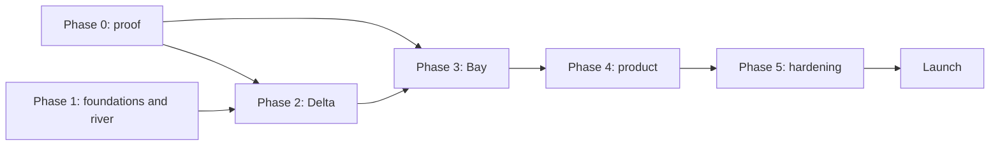

# Fischer Delta Model Returns: Build Plan

Draft for discussion · 24 November 2026 · Builds the [specification, version 1.0](specification.md)

Nothing has been built yet. This plan says what will be built, in what order, how we will know each step is done, and what has to be decided or done by people before code starts.

## 1. How the build runs

- **Six phases, 0 to 5**, as in section 10 of the specification. Each ends in something that can be seen working, and a short review with you before the next one starts.
- **Risks first.** Phase 0 proves the things that could sink the project, such as DSM2, the data feeds and NOAA's grid, before effort goes into the parts we know we can build.
- **Seams first.** The module structure, its interfaces and the checks that enforce them (specification section 4.3) exist before any model code. Every later piece is written into a slot that is already there.
- **Two regions from the start.** The plain test region (specification section 4.1) runs in the tests from the first river code, so nothing Delta-specific leaks into the engine.
- **Small, reviewable changes.** Work lands as small pull requests, one module or one feature at a time, each with its tests. Nothing merges with a failing test or a broken dependency rule.
- **One machine.** Everything server-side runs on the `webserver` host and nothing else, ever. Every other machine runs Electric Eel and is never touched. On the shared host, this app always gives way to Electric Eel.

## 2. Decisions before building

| # | Decision | Status | Choice and why |
| --- | --- | --- | --- |
| 1 | Language for the math library and compute engine | **Decided: Rust** | The only option where the math is written once and runs everywhere it is needed. It compiles to WebAssembly for the compute engine in the browser, natively for a compute engine on a server, and as a module the Python model runner calls. Strict types suit versioned interfaces. It also leaves room for 2D meshes, 3D and bioaccumulation. |
| 2 | Language for the model runner, adapters and publisher | **Decided: Python**, calling the Rust math through bindings | Python has the tools for this data: NetCDF for NOAA's files, and DWR's own Python tools for DSM2's DSS files (to confirm). The runner fetches, schedules and publishes; all its math comes from the Rust library. |
| 3 | UI stack | Recommended: TypeScript, MapLibre and Svelte | The browser needs TypeScript or JavaScript for the UI. Particles are drawn by our own graphics layer inside MapLibre; Svelte handles controls, forms, legend, timeline and graphs. Because the UI only displays, a framework change later touches only the UI. |
| 4 | Repository layout | Recommended: one repository, one package per module | `math/`, `format/`, `compute/` and `plugins/` in Rust; `runner/` and `adapters/` in Python; `ui/` in TypeScript; `regions/` and `text/` as data. Seams enforced by tooling in each language: the Rust compiler, a Python import checker and a TypeScript dependency checker. The build fails on a forbidden import. |
| 5 | Continuous integration | Recommended: GitHub Actions | Free for this public repository. Every change runs the Rust tests and WebAssembly build, the Python tests, the UI tests against recorded compute output, the dependency checks and the plug-in conformance tests. The running app never depends on GitHub. |
| 6 | How finished files reach the web edge | Path decided: `/sturgeon/` (changed from `/fischer-delta/` on 25 Nov 2026). Waiting on your OK for the web-edge change | Served at `tripofisch.com/sturgeon/` from `/srv/fdmr` on the existing web edge (container 703), through a Caddy route like Lux's `/play/`: no new hostname, no tunnel change. rsync over SSH from the model runner, with a key that can write only into that folder; each cycle goes into a new folder and one link switch makes it live. |

## 3. Things only people can do

You do these. No letter to DWR is needed: HEClib v6 is built from DWR's public source, and DWR publishes the DSM2 inputs and georeferenced grid shapefiles openly.

| Task | Why | Needed by |
| --- | --- | --- |
| Approve the model runner container on the `webserver` host, the only machine this app may use | Phase 0 needs somewhere to run DSM2 | Done 24 Nov 2026: container 705 `fdmr-runner`, 192.168.5.231, efficiency cores 12-19, 8 GB, CPU weight 25, 1 TB data disk at `/srv/fdmr-data` |
| Explain how tripofisch.com is deployed, and set up access for the push | Publishing to the web guest | Phase 1 |

**Model runner container on `webserver`, starting size:** 8 efficiency cores, 8 GB of memory (12 at most), and a 1 TB disk from the host's storage. It runs at lower CPU and disk priority than every Electric Eel container. The disk holds the data store, a year of reduced Bay archive and the published files. Phase 0 checks the size against real DSM2 timings.

## 4. Phases

Sizes are relative, from S to XL, not calendar estimates. Phase 0 sets the real numbers for the rest.

### Phase 0: proof (size M)

Answers every open question in specification section 10, before any map is drawn.

| Workstream | What gets done |
| --- | --- |
| DSM2 | Done 25 Nov 2026: built natively in the model runner (`runner/dsm2`). On DWR's historical inputs, HYDRO runs 14 days in 13 seconds and QUAL in 4. Still to do: forecast mode on our live inputs, and one run with a breach reservoir added. |
| Data feeds | Fetch every one of the twelve feeds in specification section 6 by hand. For each, record the format, how often it updates, how late it arrives, the station or product IDs, and the license terms. |
| NOAA Bay forecast | Done: 48 hours ahead, every 2 hours, about 57 MB per file, archive continuous since August 2024. Temperature and salinity checked 25 Nov 2026 against 13 stations: temperature within 0.5 degC, salinity far too salty from Richmond into Suisun Bay, so corrected daily by the stations (Data checks, Phase 4). The mesh covers Suisun Bay and the rivers to Rio Vista and Antioch. |
| Geometry | Find the river centreline, the DSM2 channel geometry and the Delta levee and island data, or how to rebuild each. |
| River data | List which gauges have field measurements and continuous conductance and temperature. Search for past dye and time-of-travel studies on the Sacramento. |

**Done when:** a written Phase 0 report answers each open question. It confirms or rejects the Chipps Island handoff, sets the wait quoted for a what-if, and fills in the feed register.

### Phase 1: foundations and the river (size XL)

The biggest phase, because it builds the skeleton everything else hangs on.

| Workstream | What gets done |
| --- | --- |
| Skeleton | Repository with one package per module; continuous integration; dependency checks that fail the build on a forbidden import. |
| Published format | Version 1 of the format, with the depth axis, substance identity and phase field already in it; a reader and writer with tests. |
| Math library, first set | Fischer dispersion, flood-wave routing, hydraulic geometry fitting, gauge-to-gauge lag analysis, 1D parcel movement, decay, certainty. Each is tested against textbook cases. |
| Data adapters | USGS, the River Forecast Center and CDEC for Keswick; the local data store. Done 25 Nov 2026: USGS (with an API key), the River Forecast Center's hourly flow forecasts at five main gauges, and the store. The Keswick release comes from the USGS gauge. CDEC done 25 Nov 2026: hourly water temperature at five stations from Keswick to Red Bluff, as tracers for calibration. |
| River model kind | Routing with both speeds kept apart; nightly calibration; skill scores. Nightly calibration running from 25 Nov 2026 (`fdmr_runner.calibrate`). Each segment gets a wave scale from release changes and a water factor from tracer signals, used only when at least three events agree. Parameters move 30% toward each night's estimate. Skill scores (before and after, in hours) are logged to `/srv/fdmr-data/calibration`. First night: Keswick to Bend Bridge from 4 release changes, arrival error 3.6 h to 0.7 h. Below Bend, too few clean changes, because tributaries blur them. With CDEC's stations added, temperature from Keswick to Bend Bridge gives 6 signals that agree: the water there is about 9% slower than the gauge-site shapes say, and travel-time error falls from 3.3 h to 2.7 h. Pairs further down disagree, because tributaries mix the signal, and are not used. Still to do: a detector for gradual release changes, one for the Colorado's daily cycle, and checking dispersion against the tracers. |
| Model runner | Scheduler and publisher; hourly river runs; the rolling 14-day past window. Done 25 Nov 2026: systemd timers in the model runner (`runner/schedule`) fetch and publish every hour at 20 past, and fetch channel measurements nightly. Each run fetches only new readings and skips a forecast already held. The newest 3 cycles are kept. The development server runs as a service. |
| Compute engine, first version | 1D tracer, flow particles and answers, behind the interface in specification 4.2, in a browser background thread. |
| UI, first version | Self-hosted map stack, flow particles, the timeline with Now, the last 14 days and the next 14, and Add pollutant. All words in text files. Done 25 Nov 2026 for the river: the next 14 days play from the forecast, the timeline is shaded by certainty, and the time reads measured, forecast or rough guide. |
| Test region | A plain river outside California, running in the tests. |

**Done when:** on a private development address, the river from Shasta Dam to Sacramento shows live flow particles and a pollutant movie across past, now and forecast. The test region runs with no engine changes. Calibration skill scores are being logged.

### Phase 2: the Delta (size L)

| Workstream | What gets done |
| --- | --- |
| DSM2 adapter | Glue that writes fetched data in DSS format, runs HYDRO and QUAL on a schedule, and reads the results into the published format. Started 25 Nov 2026: `dsstool` reads and writes DSS through HEClib, and `fdmr_runner.delta` runs DWR's historical study unchanged on our live inputs (28 days in 29 s). Over 21 days the tidal flow correlates 0.994 with Rio Vista and Jersey Point. DSM2's tides arrive 25-35 minutes early, and the swing is 1% low at Rio Vista and 16% low at Jersey Point. Net flow is a third lower than measured at both, while DSM2 balances its Freeport inflow. Looked into 25 Nov 2026 with six more gauges, means for 4 August to 24 November. DSM2 matches the measured net flow at Freeport (423 against 424 m3/s), above the Delta Cross Channel (272 against 260), through the Cross Channel (100 against 101) and below Georgiana Slough (104 against 104); Georgiana, Sutter and Steamboat Sloughs read 5-10 m3/s low, and each side channel's tidally averaged error is 6-12 m3/s. Rio Vista's gauge does not balance with them: what the gauges upstream send toward it is about 280 m3/s, and it reads 336. Its net flow is a few per cent of a tide swinging thousands of m3/s each way, so a small bias in its velocity makes a large one in its net flow. DSM2's 247 is 33 under the upstream balance: 16 in how it splits the river at Sutter and Steamboat Sloughs, and 17 taken on the way (island water use, on DWR's 2024 values, and the North Bay Aqueduct). The side channels are standing checks in every run. Forecast added 25 Nov 2026: the tide at Martinez from NOAA predictions fitted to the gauge, Freeport and Vernalis from the River Forecast Center, everything else held. A run covers 28 days back and 14 ahead in 45 s. A hindcast from 21 November, checked against the 94 hours measured since, kept the tidally averaged error at Rio Vista and Jersey Point near 60 m3/s. The moment-to-moment error grew only 18-26% on predicted tides. Published and scheduled 25 Nov 2026. Every 6 hours (00:40, 06:40, 12:40 and 18:40 UTC) DSM2 runs and its results become the `delta` reach: format 1.1, a network of 551 channels, flow at both ends of each channel, area and level, about 18 MB. Each hourly cycle hard-links in the latest run. Still to do: QUAL. |
| QUAL outputs | Salinity, temperature and the water-source fingerprint. All three done 25 Nov 2026, published every 6 hours in `<day>.quality.fdf`.

Salinity is DWR's QUAL study on live inputs: EC from Martinez (CDEC MRZ), Freeport (USGS) and Vernalis (CDEC VER), each checked against DWR's own October 2024 inputs. EC is turned into salinity by PSS-78 in the math library.

QUAL starts every channel fresh, so a run starts 120 days back: 28 days read 22-76% low. Against the five CDEC salinity stations the 120-day run reads between 13% low (Port Chicago) and 41% high (Emmaton), and 0.5% at Jersey Point.

Getting there needed two fixes. Clifton Court's gates are held open, because DWR's 2024 schedule against 2026's pumping drained the forebay. Gate settings are repeated monthly, because DSM2 reads them in monthly blocks.

The fingerprint tracks five sources (Sacramento with the Yolo Bypass, San Joaquin, eastside rivers, the sea, farm drainage) as tracers held at 100 where each enters. Rio Vista reads 93% Sacramento water; the federal pumps 73%.

Temperature is QUAL's heat budget on live weather, in a study written afresh (`fdmr_plugins.dsm2.temperature`), because DWR's temperature study reads a weather file its public release leaves out. QUAL takes one weather for the whole Delta: the mean of Sacramento Executive, Stockton and Travis airports. NOAA's hourly archive (GHCNh) covers the past; the Weather Service's observations cover its last four days, and its gridded forecast the next 7, then its last day over again. Wet bulb comes from the dew point through QUAL's own vapour-pressure formulas. Inflows take CDEC water temperatures where DWR's study takes them (Freeport, Lisbon, Vernalis, Martinez, the Mokelumne, Stockton for the Calaveras). Farm drainage takes the air's daily mean, a stand-in for DWR's unpublished monthly pattern, as a daily series because QUAL takes at most 100 at 15 minutes. Heat constants are QUAL2E's textbook values.

Against six CDEC stations over the run's last 113 days, the mean error is 0.2 °C at Rio Vista and 0.5 °C at Mallard Island and Beldon Landing. The interior Delta reads cool: 1.1 °C at Holland Cut, 1.5 °C at Old River at Highway 4 and at Turner Cut. Halving evaporation fixes the interior but makes the river 1-2 °C too warm, so the cause is the one weather for the whole Delta: the interior's sloughs are hotter and calmer than the airports.

A cycle takes 5 minutes. |
| Network tracer | Junctions, pools such as DSM2's reservoirs, and sinks such as pumps and diversions. Done 25 Nov 2026 (`fdmr-compute` `network`). Parcels move with the flow, linear along each channel, plus a random spreading step. At a junction they leave by a way water is leaving, in proportion to its flow: into a channel, into a pool, to the pumps, to another diversion, or out to sea. Pools are well mixed. A crossing made by the spreading step alone is turned back, so diversions take only their share of the flow. 14 days from 12 November on real data: released beside the federal pumps, 99% is pumped within a day; released mid-Delta near Franks Tract, 15% reaches the pumps; released at Freeport, 92% is still in the Delta. Spreading checked against QUAL 25 Nov 2026 (`tools/pulse_check.py`): an hour's pulse at the Sacramento's inflow, run in both for 12 days from 12 November, watched below Georgiana Slough, in Steamboat Slough, at Rio Vista, Jersey Point and Mallard Island. At the placeholder 50 m2/s the tracer matches QUAL's mean arrival within 1-7 hours, its spread in time within 2 hours and its peak within 8%, though less of it reaches Mallard Island within the 12 days (26% less); 10 and 200 m2/s are clearly worse, 30 and 80 about as good, so 50 stays. The tracer reaches Rio Vista about 7 hours early (162 against 169 hours) at every spreading, a small difference in how parcels move with the flow, not in spreading. |
| Delta map layer | DSM2 channels drawn on the map, each carrying its channel number. Done 25 Nov 2026: the 551 channels come from DWR's grid shapefiles (UTM converted in our code). Each is coloured by its current speed, which the compute engine works out from the published flows. |
| River to Delta | The river's outflow and load handed to DSM2 at Sacramento. Done 25 Nov 2026. Parcels passing Freeport enter the Delta at DSM2 junction 330, at the moment they arrived, with their mass. Seen working in the app. |
| Validation | DSM2 flows against Rio Vista and other stations; our tracer against QUAL on the same flow. |

**Done when:** a release anywhere from Shasta Dam to Chipps Island plays correctly through the Delta, including toward the pumps. The Delta's salinity, temperature and water-source fields are published every 6 hours.

### Phase 3: the Bay (size L)

| Workstream | What gets done |
| --- | --- |
| NOAA adapter | Fetch each cycle, reduce the mesh, and publish currents, temperature and salinity. Done 25 Nov 2026 (`fdmr_adapters.noaa_ofs`, `fdmr_plugins.fvcom`, `fdmr_runner.bay`, `regions/<id>/bay.toml`). NOAA's files are laid out identically every hour, so each is fetched as one 25.7 MB byte range of its 56.6 MB, read once and kept as its fields on the coarse mesh. The mesh is cut at Chipps Island (east of 121.915 W is the Delta's) and 20 km past the Golden Gate, and coarsened from NOAA's own nodes: shoreline first, then the rest, at twice NOAA's local spacing (80 m to 2.5 km), triangulated, with land and stray creeks dropped. 5,317 nodes and 9,265 triangles keep 99% of the water area; Carquinez Strait stays several triangles wide. Currents, temperature and salinity are depth means, moved to the coarse nodes as area-weighted means over each node's patch. Boundary edges: 37 open to the sea, 11 to the Delta at Chipps Island, the rest land (the Marin coast checked against depth). The first run took 14 days back plus the 48-hour forecast (382 hours) in 3.5 minutes; each 6-hour cycle adds about 54 hours. Published hourly as the `bay` reach (20.7 MB), every 6 hours with the Delta. First look: 0.9 m/s depth-averaged at the Golden Gate on the ebb, salinity from 33 offshore to 10 at Chipps Island. |
| 2D tracer | Parcel movement on the mesh. Engine done 25 Nov 2026 (`fdmr-compute` `mesh`): fields linear within each triangle and in time; parcels move by the random-walk form of depth-averaged advection-diffusion, dX = (u + K∇H/H) dt + √(2K) dW, with a midpoint flow step. The K∇H/H term keeps parcels from collecting in shallow water (Dimou and Adams 1993; Visser 1997). Each move is followed through the triangles it crosses: land reflects, the open sea takes parcels out, a handoff edge passes them on with where they crossed. Drying water (under 0.1 m) holds them. Tested: exact transport in uniform flow, reflection, the sea and handoff edges, mass conserved under spreading, and an even (well-mixed) start staying even over a sloping bed. In the app 25 Nov 2026: the Bay's water and flow particles drawn, releases placed in it (a click off the water snaps to the nearest water of any reach within 3 km, or places nothing). Past the end of NOAA's forecast the Bay's parcels stop rather than move on a frozen tide, until the extension below. Checked on real data (`examples/bay_release`, `tools/mesh_text.py`): releases inside the Golden Gate and in the South Bay stay in the Bay over 7 days; one in Suisun Bay crosses the Chipps Island line on the flood within two days and, with no way back yet, is lost to the Delta. The handoff must work both ways. The diffusivity K: 1.1 m2/s from 25 Nov 2026, worked out on the Bay's own mesh and currents (Data checks, Phase 4). |
| Bay extension | The fit to tides plus outflow drift, from a year of NOAA's public archive. Done 25 Nov 2026 (`fdmr_plugins.fvcom.extend`). A year of NOAA's nowcasts every 2 hours (4,381 hours, 73 GB fetched once by byte range, 274 MB kept) is fitted at every node, for u, v and level, to a mean, a term in Delta outflow (CDEC's daily net Delta outflow index, DTO) and 15 tidal constituents at Schureman's speeds (checked against NOAA's table). Refitted daily, in 4 seconds; it explains 93% of the currents' variance and 96% of the level's. Past NOAA's 48 hours the fit carries the Bay to the Delta's 14 days, plus the recent non-tidal offset (the fit's mean miss over the last 3 days), joined to NOAA's last hour over 6 hours. Outflow ahead: the last week's measured mean, moved with DSM2's tidally filtered flow at the join. Temperature and salinity are held at NOAA's last hour. |
| Chipps Island handoff | Parcels crossing in both directions; the overlap comparison with DSM2 each cycle. Crossing done 25 Nov 2026 (`fdmr_runner.handoff`, network `set_handoff`/`take_parcel`, mesh handoff edges, the worker's lockstep run). The 23 DSM2 channels whose middle lies on the Bay mesh (Mallard Island to Martinez, Grizzly and Honker Bays) are the Bay's; the Delta meets them at Chipps Island (Pittsburg and the north channel) and at four Suisun Marsh slough mouths on Grizzly Bay, so the marsh stays with DSM2, as section 7.4 asks. A parcel about to enter a Bay channel passes to the mesh at that junction; one crossing the mesh's Chipps edge comes back at the nearest junction, into a Delta channel in proportion to the flow there. The reaches run together and exchange every 5 minutes of model time, so a parcel waits at most that long at the join. Seen working in the app: a release in Suisun Bay spread over Grizzly Bay and into the Delta up Montezuma Slough and past Chipps Island, the total still exactly what was released. Still to do: the overlap comparison of the two models' flows between Chipps Island and Martinez. |
| Validation | The extension against later NOAA forecasts; the handoff mismatch; mass balance. Done 25 Nov 2026. Extension, fitted to the archive up to 14 days before now and run over those 14 days against NOAA's own nowcasts (`tools/bay_extension_check.py`): skill (1 - mean square error / variance) median over the nodes 0.92 for u, 0.90 for v, 0.95 for level (RMS 0.13 m; without the recent offset 0.80 and 0.26 m, as NOAA's mean level rose from about 0.1 m in winter to 0.4 m this autumn). Mean currents over the 14 days: Golden Gate 0.318 m/s against NOAA's 0.320, Carquinez Strait 0.088 against 0.095, Suisun Bay 0.026 against 0.027 (tides alone 0.039); the South Bay's, largely wind-driven, 0.011 against 0.038 (wind is not in the extension). At San Francisco's tide gauge the fitted amplitudes are M2 0.563, S2 0.134, K1 0.413, O1 0.277 m; NOAA's published constants times Schureman's 2026 nodal factors give 0.557, 0.137, 0.408, 0.269. Handoff: NOAA's own net flow at Chipps Island is set by its open tidal boundary near Rio Vista (1,200 m3/s inland over two tidal days, the same at Benicia; checked on NOAA's fine mesh, which the coarse mesh reproduces within 5%), so every hour gets a steady potential flow from the join to the sea (`fdmr_plugins.fvcom.correct`) that brings its tidally filtered net flow to DSM2's: 243.6 against 242.6 m3/s, within 83 m3/s at every hour; the tides are NOAA's (Chipps Island tidal flow, DSM2 7,400 m3/s, NOAA 6,500). Both are published with the reach (`overlap`, `outflow_correction`). Mass balance: exact in every test (100.0 of 100.0 kg after 14 days, across both reaches). |

**Done when:** a release travels from any point in the system to past the Golden Gate, across the handoff, for the full 14 days, with mass balance exact. Met 25 Nov 2026: a release in Suisun Bay crossed into the Delta and back at Chipps Island; one in Central Bay ran the full 14 days, out past the Golden Gate and into San Pablo and South Bays, with 100.0 of 100.0 kg accounted for. Still open: the Bay's horizontal diffusivity (2 m2/s, a placeholder until checked).

### Phase 4: the product (size XL)

| Workstream | What gets done |
| --- | --- |
| Layers and toggles | Every colour choice, net flow, and every overlay, including X2 and the station readings. Colours done 25 Nov 2026: plain, contaminant, speed, temperature, salinity, water level and water source, on colour-blind-safe scales. Net flow done 25 Nov 2026: the Delta's and the Bay's engines build a copy of their flows with Godin's tidal filter (running means over 24, 24 and 25 hours, in `fdmr_math::signal::godin`, the same filter the Bay's outflow correction uses), and in net-flow mode the flow particles move on it while parcels keep the real, instant flow. Tested on a 0.01 m/s flow under a 0.05 m/s M2 tide: net particles at 0.01 m/s within 0.001, the parcel exactly on the instant flow. X2 and stations done 25 Nov 2026 (`regions/<id>/overlays.toml`, `fdmr_runner.isohaline`, `fdmr_runner.overlays`, published as `overlays.json` with each cycle). X2 is placed where DSM2's tidally averaged conductance falls to 2.64 mS/cm (DWR's CX2 threshold) along the Sacramento axis from Martinez to Rio Vista. The axis is the network's shortest path between the two, with distances anchored at DWR's station kilometres (Martinez 56, Mallard 74, Collinsville 81, Emmaton 92, Rio Vista 100). Checked each cycle against the same position from the stations' measured surface conductance, by CX2's method extended to Emmaton (CDEC's own CX2 is posted only between 56 and 81 km): over 11–24 November 2026 the model is 0.6 km downstream on average, at most 1.8 km. NOAA's Bay salinity was set aside for X2 because it reads far too salty from Carquinez to Suisun Bay (issue #6). 35 CDEC stations from Keswick to Martinez show their latest water temperature, conductance (surface and near the bed), dissolved oxygen, turbidity and flow, with DSM2's temperature and conductance beside them where a channel is within 1 km. All stations are asked of CDEC in one request per duration. Fixed on the way: CDEC's End date stops at that day's first moment, so every CDEC fetch now asks to the day after. Until then, hourly feeds lacked the current day's readings. Dams, pumping plants and gates done 25 Nov 2026, from CDEC: Shasta's and Keswick's releases (hourly), and Shasta's inflow and water held; the Banks, Jones, Rock Slough and Barker Slough pumping (daily means, posted the next day); Clifton Court Forebay's daily inflow through its gates (their tidal operation is not published live; the model holds them open, and the map says so); and the Delta Cross Channel's position, read from its measured flow by the Delta model's own rule, so map and model agree. That rule was rewritten on the way. 'Open while the flow is at least 5 m3/s two hours running' changed state 80 times from July to November 2026, because shut gates leak up to 16 m3/s and open ones pass through zero at slack tide. It opened the gates in DSM2 for hours at a time while they were shut. Now: open from the first to the last of a run of hourly flows reaching 30 m3/s either way, each within 8 hours of the last. This finds the operations' own 13 changes. No live source was found for the Montezuma Slough Salinity Control Gates or the South Delta temporary barriers. Landmarks done 25 Nov 2026: 19 named places on the water from Keswick to the Golden Gate, each at an agency station's coordinates (USGS, NOAA, CDEC) and tied to the nearest model element (all within 0.36 km), for the arrival times; shown at first. Contra Costa's Rock Slough landmark stands where the model takes the water (DSM2 node 206); its pumping plant is 5.8 km down the canal, beyond the model (issue #5). Still to do: light and dark map styles; and a check of net flows against USGS's tidally filtered flows at Delta stations (section 9). |
| Data checks | Done 25 Nov 2026, each published with its reach every cycle (docs/format.md). **Net flows against USGS's tidally filtered flows** at 11 Delta gauges (`net_checks`; Old and Middle rivers, Grant Line Canal, Dutch and Threemile sloughs, Jersey Point, Rio Vista, Walnut Grove, Georgiana Slough). They showed that letting DSM2's island water use follow the daily net Delta consumptive use, rain included, sent the pumps' water up from the south Delta. Old River at Bacon Island read -34 m3/s against a measured -86, so the rain term is left out (dsm2.toml); DWR's own 2024 setup reads -66 against -80. The barriers' timing, Clifton Court's gates, the null-zone flows and the Jones Tract series were each tested and ruled out. DSM2's outflow past Chipps Island checked against DWR's index and USGS's Pittsburg figure (`outflow_checks`; issue #7): on 96 dry days from August to November DSM2 averages 171 m3/s against the index's 169, and USGS's figure reads about 130 above both (it sums tidally filtered net flows, which carry large biases); from dry to wet days USGS's rises about 90 and DSM2's 70 to 90, the index's 265, so its rain term overshoots. **The join:** the Bay's flow across it is DSM2's at every hour, not only on the tidal mean (largest miss 0.0 m3/s). The cut moved east to where the rivers narrow, so all open water is the mesh's (5,492 nodes; 38 DSM2 channels the mesh's). **Bay salinity and temperature** are corrected daily by 13 stations (USGS's Bay network, CDEC). NOAA read up to 16 psu too salty from Richmond into Suisun Bay; left-out checks are 0.4 to 3.7 psu, Dumbarton 7.1. Temperature was within 0.5 degC. **Flow particles** live 3 to 9 hours of model time and start again on wet water, so the Bay no longer empties into the shallows; one crossing the join carries on in the other reach, taken in with the chance that keeps the two reaches' particles per m3 of water even, and landing anywhere in the triangle at a channel's mouth, not on one point. Particles that follow depth-averaged currents settle at a density in proportion to depth, so the deep channels show more of them, as they carry more water. **The Bay's diffusivity K** is 1.1 m2/s, worked out from Okubo's and Elder's relations on the Bay's own mesh and currents, in place of the 2 m2/s placeholder. **USGS stations with several sensors** are read one sensor at a time. Freeport's temperature had been mixing two sensors (0.1 degC apart) and was fetched again. |
| Colour scales | Multi-hue from 25 Nov 2026 (`ui/src/ui/layers.ts`): speed, temperature and salinity run through the Okabe-Ito colours in hue order, so the middle of each scale stands out, not only its ends. Salinity changes hue at the Venice System's classes (fresh below 0.5 psu, oligohaline to 5, mesohaline to 18, polyhaline to 30), so the mixing zone shows. Temperature changes hue at 13.3 degC (56 degF, the winter-run limit below Keswick) and 20 degC (salmon migration). Water level keeps its diverging purple-orange. |
| Export canals | Done 26 Nov 2026 (issue #5; `fdmr_runner.canals`, regions/sf-bay-delta/canals.toml): the California Aqueduct, Delta-Mendota Canal, Contra Costa Canal and North Bay Aqueduct as one network reach, fed through `outlets` by the Delta's exports, which now pass parcels and particles on instead of removing them. Lines from DWR's State Water Project centreline (CC-BY) and USGS's National Hydrography Dataset, built once into canals.json; published hourly with each DSM2 run (5.7 MB for 28 days). Checked live 26 Nov 2026: a release in Old River by the pumps went through Clifton Court into both canals, and the mass balance held (52.3 kg in the Delta, 45.9 kg in the canals, 1.7 kg to other diversions). |
| Rivers from their dams | Done 26 Nov 2026 (issue #4): twelve river-routing reaches besides the Sacramento, each from its first dam (the American from Nimbus, Feather from Thermalito with the Yuba and Bear, Mokelumne from Camanche, Cosumnes from Michigan Bar, Calaveras from New Hogan, San Joaquin from above the Merced with the Tuolumne, Stanislaus and Merced, and Cache Creek from Clear Lake), handing on into the river they join or into the Delta at DSM2's inflow junction. CDEC stations serve where USGS has no live gauge, placed by the USGS site beside them or by their coordinates (checked within 300 m of the river; CDEC's coordinates for OBB lie in the Delta, so it is placed by USGS 11302000). Their CDEC river stations and dams' releases are on the map. On the way, CDEC's missing-data markers -9997 and -9998 were found stored as flows (17,499 readings, mostly two new stations, MCC and LGN); they are now skipped and were removed. None was in the Delta model's CDEC flow inputs over the past year (checked at all seven). Travel times are calibrated nightly where a live gauge stands below the release (Feather, Yuba, Cosumnes, San Joaquin, Tuolumne, Stanislaus, Merced, Cache). Searched 26 Nov 2026 (USGS discharge reported in the last 30 days, and CDEC's 475 live flow stations): there is none below the American's (Fair Oaks), the Bear's (Wheatland), the Mokelumne's (Camanche, down to the tidal Delta) or the Calaveras's (New Hogan; Bellota's gauge is on Mormon Slough), so those four are not calibrated; the American's carriage is still checked by the three USGS temperature stations below Fair Oaks. Putah Creek and the rest of Cache Creek end in the Yolo Bypass, which is not modelled; they move to that work (issue #15). Putah's release has two candidate CDEC flows at the diversion dam (Solano County Water Agency's PTF, 70 cfs, and PRF, 19 cfs, 26 Nov) that together match the flow above it, and which is the creek is not yet confirmed. |
| More Bay stations | 26 Nov 2026 (issue #8): of the sources found, CeNCOOS's Carquinez, Tiburon and Fort Point sensors are no longer reporting. Live and new: the SF Bay estuarine reserve's China Camp sonde through NOAA NDBC (`fdmr_adapters.ndbc`, temperature and salinity), and NOAA's tide stations' water temperature at Alameda, Richmond and Port Chicago (`noaa_tides.fetch_water_temperature`). Tried as inputs to the Bay correction they made it worse (China Camp, a marsh-edge cove 7.6 psu fresher than the model, doubled the left-out miss at the Richmond-San Rafael Bridge), so they are checks only: the corrected Bay misses them by 0.03-0.52 degC and, at China Camp, 2.9 psu. The reserve's Rush Ranch sondes are in Suisun Marsh sloughs, the Delta model's water, and are left for its checks. |
| Every source in use | 26 Nov 2026 (issue #8): every live source found is used where it applies. The map shows 52 stations from CDEC, USGS, NOAA NDBC (the estuarine reserve's China Camp, First and Second Mallard and Rush Ranch weather), NOAA CO-OPS and CeNCOOS (the Exploratorium; Tiburon when it reports), each beside the value of whichever model covers it (a Delta channel, a river element or a Bay node within 1 km; channels the Bay owns are left to it), and each cycle publishes every station's 14-day misfit against that model. The Exploratorium and Tiburon are independent checks on the Bay's correction (Exploratorium: 0.13 degC, 0.17 psu). Rush Ranch's weather joins the Delta's three airports. High-frequency radar checks the Bay's currents (253 cells, 333 hours: radar 0.31 m/s at the surface against the mesh's depth-averaged 0.39; correlation 0.55, the mesh turned 19 degrees). SWOT checks the Sacramento's widths (35 SWORD reaches; the model's run at 0.83 of SWOT's, median); its water level is not used, scattering by metres on a river this narrow. |
| Satellite water temperature | 26 Nov 2026 (issue #8): NASA ECOSTRESS (70 m, water-surface temperature, ECO_L2T_LSTE v003 through LP DAAC with an Earthdata token; `fdmr_adapters.ecostress`) checks every model each cycle (overlays.json `satellite_temperature`). Each pass's water pixels are kept where the product's masks say clear water of good quality and no cloud lies within 350 m; a point counts only where its pixel and the eight around it are all kept, so no land or cloud edge is mixed in. Without the 350 m guard, pixels beside flagged cloud read up to 6.3 degC cold against the stations; with it, 15 stations over the first 3 passes: satellite less station -0.18 degC, RMS 0.40. Over 17 passes (to 26 Nov) it widened to -0.69, RMS 1.39 at 16 stations, mostly harbour and pier gauges (NOAA Port Chicago -2.85): some passes still read cold, so it stays a check, its own miss published beside it. Against the models (satellite less model): the Bay 3,806 nodes +0.28 (RMS 0.78), the Delta 100 channels +0.34 (0.97), the Sacramento 61 elements -1.27 (1.79): the river model reads warmer than the satellite, a lead for the validation work (#9), not yet a finding. Tried and not used: NASA JPL's MUR sea-surface temperature analysis (1 km, gap-filled). It matched the offshore buoys 46026 and 46012 to 0.2 degC, but read 1.3 degC warm at the San Francisco Bar buoy and 2.1-3.0 degC warm at five Bay stations over 14 days: it carries the ocean's warmth into the Bay. The Bar buoy (NDBC 46237) is now an independent check on the Bay's ocean edge. |
| River temperature | Done 26 Nov 2026 (`fdmr_plugins.river_routing.heat`, region.toml `[river_temperature]`, each reach's `release_temperature`): for every river whose release temperature is measured live (Sacramento at Keswick, American, Feather below Thermalito, Calaveras, San Joaquin, Tuolumne, Stanislaus), the release's water carried down at the water's speed, warming and cooling with the nearest of eight airports' weather (NOAA GHCNh and Weather Service observations, then its forecast), tributaries mixing in, then corrected toward 20 CDEC and USGS stations (inventory checked against their own data, 25-26 Nov; stations whose data proved dead left out, and two whose CDEC coordinates lie more than 500 m off the river, FTA and VER). Before correction the model runs cool downstream in late November: 0.7 degC at Freeport, 1.8 degC on the shallow Tuolumne at Modesto. QUAL2K's cloud term on the sky's long-wave took the Freeport misfit from 1.3 to 0.7 degC; wind sheltering did little; what remains looks like the riverbed's stored heat, which the model leaves out. After correction every station is met; left out in turn, the stations are missed by 0.2-0.8 degC RMS on the Sacramento, American and Feather, 2.1 on the Tuolumne. The rivers show as fresh water on the salinity layer. |
| Prediction ledger | Started 26 Nov 2026 (issue #9, part 2; `fdmr_runner.ledger`). Four cycles a day keep their predictions at 89 check points: water temperature at 39 map stations (Delta 24, Bay 10, rivers 5), conductance at 23 and salinity at 4, flow at 17 river gauges below the releases and 6 Delta flow stations; hourly to 48 hours ahead, six-hourly to 15 days, about 8,500 values and 0.3 MB a cycle, beside the cycle's own index.json. Each cycle scores every kept prediction whose time has come against the nearest reading (measured less predicted, by reach, quantity and lead time, last 30 days) and publishes it as skill.json. Still to come in #9: rolling hindcasts (every reach run as of a past time), and tuning against held-out hindcasts (the nightly refinement), after more data is in. |
| Reservoirs and snowpack | 26 Nov 2026 (issue #13). The reservoir above each river's first dam is on the map with its storage, inflow and release (CDEC sensors 15, 76, 23; hourly, or daily where the operator reports only that): Trinity, Shasta, Oroville, New Bullards Bar, Folsom, Pardee, Camanche, New Hogan, New Melones, Don Pedro, McClure and Millerton. DWR's daily reservoir report gives each capacity and the historical average for the date (`fdmr_adapters.cdec_reports`); on 26 Nov the published percent full and percent of average matched the report's own to its rounding (Shasta 50 and 93, Oroville 42 and 82, Folsom 38 and 96, New Hogan 48 and 138, New Melones 63 and 118, Millerton 45 and 101). The snowpack of each reservoir's basin group comes from DWR's reviewed snow sensor values (Page 6), not the raw sensors: early in the season a raw pillow read 4.5 inches at Kettle Rock where DWR's reviewed value was nil. DWR's North, Central and South summaries are kept too. All are kept in the store each day, the record of what fed the rivers for the validation work (#9). |
| Land temperature | 26 Nov 2026 (issue #11; `fdmr_runner.land`, `ecostress.fetch_land`). The river heat model takes its air temperature from the nearest of eight airports. ECOSTRESS's land surface temperature (70 m) is averaged at each pass over the land within 1 km of every river stretch, split by the airport it takes, and within 2 km of each airport; clear land only, 350 m from flagged cloud. The means are kept in the store (33 places), and each cycle publishes each stretch's contrast with its airport's land over the last 14 days, day and night apart. First passes (daytime, 26 Nov): most stretches within 0.5 degC of their airport; the Tuolumne, Merced, Stanislaus and lower San Joaquin 1.5-3.2 degC cooler than the land at Modesto's airport, a lead for the Tuolumne's 2.1 degC temperature miss (#9). A failed download is retried twice and then left for the next cycle. |
| Soil moisture | 26 Nov 2026 (issue #12; `fdmr_adapters.smap`, `fdmr_runner.soil`). NASA SMAP's Level 4 soil moisture (SPL4SMGP v008: 9 km, three-hourly, about two days behind, gap-free), cut to our area through NASA's OPeNDAP service (48 KB a period instead of the 140 MB global file), averaged over 15 areas where rain runs off unmeasured: the land within 10 km of each river below its dam, and boxes round the Delta's lowlands and the land draining to the Bay. Kept in the store every period; each cycle publishes each area's surface and root-zone moisture, wetness, percentile against its own climate and 7-day change. On 26 Nov (period of 24 Nov) the root zone stood at the 86th to 99th percentile everywhere (the Delta 98.8, along the San Joaquin 99.5), and had wetted over the week. A record for the validation work (#9), not yet an input. |
| Weather over the water | 26 Nov 2026 (issue #9's tracking list). NOAA's seven tide stations (Golden Gate, Point Reyes, Redwood City, Alameda, Richmond, Martinez, Port Chicago) now give water level, wind and air pressure as well as water temperature (`noaa_tides.fetch_observed`), with their tide predictions; the three offshore buoys (NDBC 46026, 46012, 46013) give wind, pressure and air and sea temperature. Each cycle publishes the tide residual, measured less predicted, at each tide station: on 26 Nov about +0.3 m everywhere over the week (Point Reyes +0.35, on the open coast), peaks +0.43 to +0.51 m (Port Chicago, at the Delta end, the highest). NOAA's daily upwelling index (CUTI) runs two months behind and is not used; the buoys show upwelling as it happens. |
| Check page | 26 Nov 2026: `check.html` beside the map lays out every check the current cycle publishes, as plain tables, for verifying the maths: the prediction ledger's skill, the stations against the model covering them, the satellite temperature check, the reservoirs and snowpack, and each reach's own checks. It reads the published files and computes nothing. |
| Releases | Outfalls, decay, up to five releases at once. |
| Answers | Read-off answers, landmarks and certainty in words. |
| What-ifs | The menu of dam releases and levee breaches, with the weir and pool pieces. A small request service on the model runner, behind a route on the web edge, runs a what-if when asked: menu choices only, one at a time, kept until the next cycle. The UI says it takes a few minutes and shows progress. In spare time, when the whole host has been quiet for 30 minutes, it works through the rest of the menu; visitors always come first. |
| History | A simple text History page, with the words from you. |
| Finish | Phone layout, and the Utilities page on tripofisch.com. |
| Front-page tile | At launch the app gets a tile on the tripofisch.com front page, like the other utilities: a short description, a logo and its name. The name is **Sturgeon** (decided 25 Nov 2026); the logo is a sturgeon in a ring marked salinity, flow rate, temperature and depth. |

**Done when:** every user-facing item in specification section 3 works on a phone and a desktop.

### Phase 5: hardening and launch (size M)

| Workstream | What gets done |
| --- | --- |
| Validation checks | Every row of specification 9.2 runs as an automated test. No separate report. |
| Operations | The status file already shows how old the data is. Add a notice to you when a run fails, and test that stale data is shown honestly. |
| Performance | Parcel and particle counts tuned by measured frame rate. |
| Accessibility | Colour-blind checks on every scale. |
| Review | License and credits review. |

**Done when:** it has run unattended for two weeks without a gap. Then launch: the San Francisco Bay, Delta and river region, Shasta Dam to the Golden Gate, online at `tripofisch.com/sturgeon/` with its models running.

### After launch

In no fixed order:
- bioaccumulation
- custom what-ifs
- the Feather from Oroville Dam and the American from Folsom Dam as river reaches, each handed on into the Sacramento (spec section 3.13)
- sediment transport, including Cathy Van Ingen's work (spec section 3.12)
- river levels and floods: flood stage, flood maps, floodplain flow, snowmelt, storm and dam-failure what-ifs (spec section 3.11), including flood spill into the bypasses
- ensemble spread
- the 1D tidal model decision
- the second region
- 3D plug-ins

## 5. Order and overlap

- Phase 1 starts alongside Phase 0 (decided). It does not depend on DSM2 or NOAA, so nothing waits for the Phase 0 report except Phases 2 and 3.
- Phase 2 cannot start until Phase 0 has DSM2 running and the Delta geometry in hand.

## 6. Risks

| Risk | What happens if it bites | What we do |
| --- | --- | --- |
| DSM2 channel geometry is not available outside DWR | No Delta map layer | Rebuild it from DSM2's published channel inputs and the river centrelines. That is slower, but possible. |
| A DSM2 run is too slow | Visitors wait longer for a what-if | The app quotes the real wait, measured in Phase 0. |
| NOAA's mesh is too coarse at Chipps Island | The handoff moves to Martinez | Fallback already in specification 7.4. |
| A feed is late, sparse or changes format | Gaps in the past window, or a weaker forecast | The local store, data age shown on screen, and an adapter per source so one break stays contained. |
| This app competes with Electric Eel on the shared host | Electric Eel slows | Fixed caps, lower CPU and disk priority, pinned to efficiency cores; Phase 0 measures the real load. |
| A bad Caddy change breaks the shared web edge | Every site on it goes down, Electric Eel included | Check the config before reloading, reload rather than restart, keep the previous file, and change it only with your OK. |
| Phones cannot keep up | Choppy movie | Parcel counts set by device; measured in Phase 4. |
| A data source's license forbids our use | That feed cannot be used | Checked for every feed in Phase 0. |
| Scope: temperature, salinity and what-ifs add a lot | Launch slips | They sit in Phases 2 to 4, after the core works, and can move after launch if needed. |

## 7. Questions for our discussion

1. Decisions 3 to 5 in section 2: keep as recommended? Decision 6 needs a description of how tripofisch.com is hosted today.
2. Answered: you send the one DWR letter in section 3.
3. Answered: Phase 1 starts alongside Phase 0.
4. Answered: launch is the San Francisco Bay, Delta and river region, Shasta Dam to the Golden Gate, online with its models running.
5. Where should the development address live while we build: on your hardware, or somewhere private?
