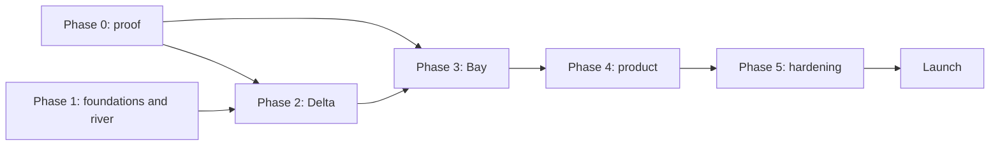

# Fischer Delta Model Returns: Build Plan

Draft for discussion · 24 November 2026 · Builds the [specification, version 1.0](specification.md)

Nothing has been built yet. This plan says what will be built, in what order, how we will know each step is done, and what has to be decided or done by people before code starts.

## 1. How the build runs

- **Six phases, 0 to 5**, as in section 10 of the specification. Each ends in something that can be seen working, and a short review with you before the next one starts.
- **Risks first.** Phase 0 proves the things that could sink the project, such as DSM2, the data feeds and NOAA's grid, before effort goes into the parts we know we can build.
- **Seams first.** The module structure, its interfaces and the checks that enforce them (specification section 4.3) exist before any model code. Every later piece is written into a slot that is already there.
- **Two regions from the start.** The plain test region (specification section 4.1) runs in the tests from the first river code, so nothing Delta-specific leaks into the engine.
- **Small, reviewable changes.** Work lands as small pull requests, one module or one feature at a time, each with its tests. Nothing merges with a failing test or a broken dependency rule.
- **One machine.** Everything server-side runs on the `webserver` host and nothing else, ever. Every other machine runs Electric Eel and is never touched. On the shared host, this app always gives way to Electric Eel.

## 2. Decisions before building

| # | Decision | Status | Choice and why |
| --- | --- | --- | --- |
| 1 | Language for the math library and compute engine | **Decided: Rust** | The only option where the math is written once and runs everywhere it is needed. It compiles to WebAssembly for the compute engine in the browser, natively for a compute engine on a server, and as a module the Python model runner calls. Strict types suit versioned interfaces. It also leaves room for 2D meshes, 3D and bioaccumulation. |
| 2 | Language for the model runner, adapters and publisher | **Decided: Python**, calling the Rust math through bindings | Python has the tools for this data: NetCDF for NOAA's files, and DWR's own Python tools for DSM2's DSS files (to confirm). The runner fetches, schedules and publishes; all its math comes from the Rust library. |
| 3 | UI stack | Recommended: TypeScript, MapLibre and Svelte | The browser needs TypeScript or JavaScript for the UI. Particles are drawn by our own graphics layer inside MapLibre; Svelte handles controls, forms, legend, timeline and graphs. Because the UI only displays, a framework change later touches only the UI. |
| 4 | Repository layout | Recommended: one repository, one package per module | `math/`, `format/`, `compute/` and `plugins/` in Rust; `runner/` and `adapters/` in Python; `ui/` in TypeScript; `regions/` and `text/` as data. Seams enforced by tooling in each language: the Rust compiler, a Python import checker and a TypeScript dependency checker. The build fails on a forbidden import. |
| 5 | Continuous integration | Recommended: GitHub Actions | Free for this public repository. Every change runs the Rust tests and WebAssembly build, the Python tests, the UI tests against recorded compute output, the dependency checks and the plug-in conformance tests. The running app never depends on GitHub. |
| 6 | How finished files reach the web edge | Path decided: `/sturgeon/` (changed from `/fischer-delta/` on 25 Nov 2026). Waiting on your OK for the web-edge change | Served at `tripofisch.com/sturgeon/` from `/srv/fdmr` on the existing web edge (container 703), through a Caddy route like Lux's `/play/`: no new hostname, no tunnel change. rsync over SSH from the model runner, with a key that can write only into that folder; each cycle goes into a new folder and one link switch makes it live. |

## 3. Things only people can do

You do these. No letter to DWR is needed: HEClib v6 is built from DWR's public source, and DWR publishes the DSM2 inputs and georeferenced grid shapefiles openly.

| Task | Why | Needed by |
| --- | --- | --- |
| Approve the model runner container on the `webserver` host, the only machine this app may use | Phase 0 needs somewhere to run DSM2 | Done 24 Nov 2026: container 705 `fdmr-runner`, 192.168.5.231, efficiency cores 12-19, 8 GB, CPU weight 25, 1 TB data disk at `/srv/fdmr-data` |
| Explain how tripofisch.com is deployed, and set up access for the push | Publishing to the web guest | Phase 1 |

**Model runner container on `webserver`, starting size:** 8 efficiency cores, 8 GB of memory (12 at most), and a 1 TB disk from the host's storage. It runs at lower CPU and disk priority than every Electric Eel container. The disk holds the data store, a year of reduced Bay archive and the published files. Phase 0 checks the size against real DSM2 timings.

## 4. Phases

Sizes are relative, from S to XL, not calendar estimates. Phase 0 sets the real numbers for the rest.

### Phase 0: proof (size M)

Answers every open question in specification section 10, before any map is drawn.

| Workstream | What gets done |
| --- | --- |
| DSM2 | Done 25 Nov 2026: built natively in the model runner (`runner/dsm2`). On DWR's historical inputs, HYDRO runs 14 days in 13 seconds and QUAL in 4. Still to do: forecast mode on our live inputs, and one run with a breach reservoir added. |
| Data feeds | Fetch every one of the twelve feeds in specification section 6 by hand. For each, record the format, how often it updates, how late it arrives, the station or product IDs, and the license terms. |
| NOAA Bay forecast | Done: 48 hours ahead, every 2 hours, about 57 MB per file, archive continuous since August 2024. Still to check: the temperature and salinity variables and depths, and how finely the mesh covers Suisun Bay up to Chipps Island. |
| Geometry | Find the river centreline, the DSM2 channel geometry and the Delta levee and island data, or how to rebuild each. |
| River data | List which gauges have field measurements and continuous conductance and temperature. Search for past dye and time-of-travel studies on the Sacramento. |

**Done when:** a written Phase 0 report answers each open question. It confirms or rejects the Chipps Island handoff, sets the wait quoted for a what-if, and fills in the feed register.

### Phase 1: foundations and the river (size XL)

The biggest phase, because it builds the skeleton everything else hangs on.

| Workstream | What gets done |
| --- | --- |
| Skeleton | Repository with one package per module; continuous integration; dependency checks that fail the build on a forbidden import. |
| Published format | Version 1 of the format, with the depth axis, substance identity and phase field already in it; a reader and writer with tests. |
| Math library, first set | Fischer dispersion, flood-wave routing, hydraulic geometry fitting, gauge-to-gauge lag analysis, 1D parcel movement, decay, certainty. Each is tested against textbook cases. |
| Data adapters | USGS, the River Forecast Center and CDEC for Keswick; the local data store. Done 25 Nov 2026: USGS (with an API key), the River Forecast Center's hourly flow forecasts at five main gauges, and the store. The Keswick release comes from the USGS gauge. CDEC done 25 Nov 2026: hourly water temperature at five stations from Keswick to Red Bluff, as tracers for calibration. |
| River model kind | Routing with both speeds kept apart; nightly calibration; skill scores. Nightly calibration running from 25 Nov 2026 (`fdmr_runner.calibrate`). Each segment gets a wave scale from release changes and a water factor from tracer signals, used only when at least three events agree. Parameters move 30% toward each night's estimate. Skill scores (before and after, in hours) are logged to `/srv/fdmr-data/calibration`. First night: Keswick to Bend Bridge from 4 release changes, arrival error 3.6 h to 0.7 h. Below Bend, too few clean changes, because tributaries blur them. With CDEC's stations added, temperature from Keswick to Bend Bridge gives 6 signals that agree: the water there is about 9% slower than the gauge-site shapes say, and travel-time error falls from 3.3 h to 2.7 h. Pairs further down disagree, because tributaries mix the signal, and are not used. Still to do: a detector for gradual release changes, one for the Colorado's daily cycle, and checking dispersion against the tracers. |
| Model runner | Scheduler and publisher; hourly river runs; the rolling 14-day past window. Done 25 Nov 2026: systemd timers in the model runner (`runner/schedule`) fetch and publish every hour at 20 past, and fetch channel measurements nightly. Each run fetches only new readings and skips a forecast already held. The newest 3 cycles are kept. The development server runs as a service. |
| Compute engine, first version | 1D tracer, flow particles and answers, behind the interface in specification 4.2, in a browser background thread. |
| UI, first version | Self-hosted map stack, flow particles, the timeline with Now, the last 14 days and the next 14, and Add pollutant. All words in text files. Done 25 Nov 2026 for the river: the next 14 days play from the forecast, the timeline is shaded by certainty, and the time reads measured, forecast or rough guide. |
| Test region | A plain river outside California, running in the tests. |

**Done when:** on a private development address, the river from Shasta Dam to Sacramento shows live flow particles and a pollutant movie across past, now and forecast. The test region runs with no engine changes. Calibration skill scores are being logged.

### Phase 2: the Delta (size L)

| Workstream | What gets done |
| --- | --- |
| DSM2 adapter | Glue that writes fetched data in DSS format, runs HYDRO and QUAL on a schedule, and reads the results into the published format. Started 25 Nov 2026: `dsstool` reads and writes DSS through HEClib, and `fdmr_runner.delta` runs DWR's historical study unchanged on our live inputs (28 days in 29 s). Over 21 days the tidal flow correlates 0.994 with Rio Vista and Jersey Point. DSM2's tides arrive 25-35 minutes early, and the swing is 1% low at Rio Vista and 16% low at Jersey Point. Net flow is a third lower than measured at both, while DSM2 balances its Freeport inflow. Looked into 25 Nov 2026 with six more gauges, means for 4 August to 24 November. DSM2 matches the measured net flow at Freeport (423 against 424 m3/s), above the Delta Cross Channel (272 against 260), through the Cross Channel (100 against 101) and below Georgiana Slough (104 against 104); Georgiana, Sutter and Steamboat Sloughs read 5-10 m3/s low, and each side channel's tidally averaged error is 6-12 m3/s. Rio Vista's gauge does not balance with them: what the gauges upstream send toward it is about 280 m3/s, and it reads 336. Its net flow is a few per cent of a tide swinging thousands of m3/s each way, so a small bias in its velocity makes a large one in its net flow. DSM2's 247 is 33 under the upstream balance: 16 in how it splits the river at Sutter and Steamboat Sloughs, and 17 taken on the way (island water use, on DWR's 2024 values, and the North Bay Aqueduct). The side channels are standing checks in every run. Forecast added 25 Nov 2026: the tide at Martinez from NOAA predictions fitted to the gauge, Freeport and Vernalis from the River Forecast Center, everything else held. A run covers 28 days back and 14 ahead in 45 s. A hindcast from 21 November, checked against the 94 hours measured since, kept the tidally averaged error at Rio Vista and Jersey Point near 60 m3/s. The moment-to-moment error grew only 18-26% on predicted tides. Published and scheduled 25 Nov 2026. Every 6 hours (00:40, 06:40, 12:40 and 18:40 UTC) DSM2 runs and its results become the `delta` reach: format 1.1, a network of 551 channels, flow at both ends of each channel, area and level, about 18 MB. Each hourly cycle hard-links in the latest run. Still to do: QUAL. |
| QUAL outputs | Salinity, temperature and the water-source fingerprint. All three done 25 Nov 2026, published every 6 hours in `<day>.quality.fdf`.

Salinity is DWR's QUAL study on live inputs: EC from Martinez (CDEC MRZ), Freeport (USGS) and Vernalis (CDEC VER), each checked against DWR's own October 2024 inputs. EC is turned into salinity by PSS-78 in the math library.

QUAL starts every channel fresh, so a run starts 120 days back: 28 days read 22-76% low. Against the five CDEC salinity stations the 120-day run reads between 13% low (Port Chicago) and 41% high (Emmaton), and 0.5% at Jersey Point.

Getting there needed two fixes. Clifton Court's gates are held open, because DWR's 2024 schedule against 2026's pumping drained the forebay. Gate settings are repeated monthly, because DSM2 reads them in monthly blocks.

The fingerprint tracks five sources (Sacramento with the Yolo Bypass, San Joaquin, eastside rivers, the sea, farm drainage) as tracers held at 100 where each enters. Rio Vista reads 93% Sacramento water; the federal pumps 73%.

Temperature is QUAL's heat budget on live weather, in a study written afresh (`fdmr_plugins.dsm2.temperature`), because DWR's temperature study reads a weather file its public release leaves out. QUAL takes one weather for the whole Delta: the mean of Sacramento Executive, Stockton and Travis airports. NOAA's hourly archive (GHCNh) covers the past; the Weather Service's observations cover its last four days, and its gridded forecast the next 7, then its last day over again. Wet bulb comes from the dew point through QUAL's own vapour-pressure formulas. Inflows take CDEC water temperatures where DWR's study takes them (Freeport, Lisbon, Vernalis, Martinez, the Mokelumne, Stockton for the Calaveras). Farm drainage takes the air's daily mean, a stand-in for DWR's unpublished monthly pattern, as a daily series because QUAL takes at most 100 at 15 minutes. Heat constants are QUAL2E's textbook values.

Against six CDEC stations over the run's last 113 days, the mean error is 0.2 °C at Rio Vista and 0.5 °C at Mallard Island and Beldon Landing. The interior Delta reads cool: 1.1 °C at Holland Cut, 1.5 °C at Old River at Highway 4 and at Turner Cut. Halving evaporation fixes the interior but makes the river 1-2 °C too warm, so the cause is the one weather for the whole Delta: the interior's sloughs are hotter and calmer than the airports.

A cycle takes 5 minutes. |
| Network tracer | Junctions, pools such as DSM2's reservoirs, and sinks such as pumps and diversions. Done 25 Nov 2026 (`fdmr-compute` `network`). Parcels move with the flow, linear along each channel, plus a random spreading step. At a junction they leave by a way water is leaving, in proportion to its flow: into a channel, into a pool, to the pumps, to another diversion, or out to sea. Pools are well mixed. A crossing made by the spreading step alone is turned back, so diversions take only their share of the flow. 14 days from 12 November on real data: released beside the federal pumps, 99% is pumped within a day; released mid-Delta near Franks Tract, 15% reaches the pumps; released at Freeport, 92% is still in the Delta. Spreading checked against QUAL 25 Nov 2026 (`tools/pulse_check.py`): an hour's pulse at the Sacramento's inflow, run in both for 12 days from 12 November, watched below Georgiana Slough, in Steamboat Slough, at Rio Vista, Jersey Point and Mallard Island. At the placeholder 50 m2/s the tracer matches QUAL's mean arrival within 1-7 hours, its spread in time within 2 hours and its peak within 8%, though less of it reaches Mallard Island within the 12 days (26% less); 10 and 200 m2/s are clearly worse, 30 and 80 about as good, so 50 stays. The tracer reaches Rio Vista about 7 hours early (162 against 169 hours) at every spreading, a small difference in how parcels move with the flow, not in spreading. |
| Delta map layer | DSM2 channels drawn on the map, each carrying its channel number. Done 25 Nov 2026: the 551 channels come from DWR's grid shapefiles (UTM converted in our code). Each is coloured by its current speed, which the compute engine works out from the published flows. |
| River to Delta | The river's outflow and load handed to DSM2 at Sacramento. Done 25 Nov 2026. Parcels passing Freeport enter the Delta at DSM2 junction 330, at the moment they arrived, with their mass. Seen working in the app. |
| Validation | DSM2 flows against Rio Vista and other stations; our tracer against QUAL on the same flow. |

**Done when:** a release anywhere from Shasta Dam to Chipps Island plays correctly through the Delta, including toward the pumps. The Delta's salinity, temperature and water-source fields are published every 6 hours.

### Phase 3: the Bay (size L)

| Workstream | What gets done |
| --- | --- |
| NOAA adapter | Fetch each cycle, reduce the mesh, and publish currents, temperature and salinity. |
| 2D tracer | Parcel movement on the mesh. |
| Bay extension | The fit to tides plus outflow drift, from a year of NOAA's public archive. |
| Chipps Island handoff | Parcels crossing in both directions; the overlap comparison with DSM2 each cycle. |
| Validation | The extension against later NOAA forecasts; the handoff mismatch; mass balance. |

**Done when:** a release travels from any point in the system to past the Golden Gate, across the handoff, for the full 14 days, with mass balance exact.

### Phase 4: the product (size XL)

| Workstream | What gets done |
| --- | --- |
| Layers and toggles | Every colour choice, net flow, and every overlay, including X2 and the station readings. |
| River temperature | The 1D heat model and the weather adapter. |
| Releases | Outfalls, decay, up to five releases at once. |
| Answers | Read-off answers, landmarks and certainty in words. |
| What-ifs | The menu of dam releases and levee breaches, with the weir and pool pieces. A small request service on the model runner, behind a route on the web edge, runs a what-if when asked: menu choices only, one at a time, kept until the next cycle. The UI says it takes a few minutes and shows progress. In spare time, when the whole host has been quiet for 30 minutes, it works through the rest of the menu; visitors always come first. |
| History | A simple text History page, with the words from you. |
| Finish | Phone layout, and the Utilities page on tripofisch.com. |
| Front-page tile | At launch the app gets a tile on the tripofisch.com front page, like the other utilities: a short description, a logo and its name. The name is **Sturgeon** (decided 25 Nov 2026); the logo is a sturgeon in a ring marked salinity, flow rate, temperature and depth. |

**Done when:** every user-facing item in specification section 3 works on a phone and a desktop.

### Phase 5: hardening and launch (size M)

| Workstream | What gets done |
| --- | --- |
| Validation checks | Every row of specification 9.2 runs as an automated test. No separate report. |
| Operations | The status file already shows how old the data is. Add a notice to you when a run fails, and test that stale data is shown honestly. |
| Performance | Parcel and particle counts tuned by measured frame rate. |
| Accessibility | Colour-blind checks on every scale. |
| Review | License and credits review. |

**Done when:** it has run unattended for two weeks without a gap. Then launch: the San Francisco Bay, Delta and river region, Shasta Dam to the Golden Gate, online at `tripofisch.com/sturgeon/` with its models running.

### After launch

In no fixed order:
- bioaccumulation
- custom what-ifs
- the Feather from Oroville Dam and the American from Folsom Dam as river reaches, each handed on into the Sacramento (spec section 3.13)
- sediment transport, including Cathy Van Ingen's work (spec section 3.12)
- river levels and floods: flood stage, flood maps, floodplain flow, snowmelt, storm and dam-failure what-ifs (spec section 3.11), including flood spill into the bypasses
- ensemble spread
- the 1D tidal model decision
- the second region
- 3D plug-ins

## 5. Order and overlap

- Phase 1 starts alongside Phase 0 (decided). It does not depend on DSM2 or NOAA, so nothing waits for the Phase 0 report except Phases 2 and 3.
- Phase 2 cannot start until Phase 0 has DSM2 running and the Delta geometry in hand.

## 6. Risks

| Risk | What happens if it bites | What we do |
| --- | --- | --- |
| DSM2 channel geometry is not available outside DWR | No Delta map layer | Rebuild it from DSM2's published channel inputs and the river centrelines. That is slower, but possible. |
| A DSM2 run is too slow | Visitors wait longer for a what-if | The app quotes the real wait, measured in Phase 0. |
| NOAA's mesh is too coarse at Chipps Island | The handoff moves to Martinez | Fallback already in specification 7.4. |
| A feed is late, sparse or changes format | Gaps in the past window, or a weaker forecast | The local store, data age shown on screen, and an adapter per source so one break stays contained. |
| This app competes with Electric Eel on the shared host | Electric Eel slows | Fixed caps, lower CPU and disk priority, pinned to efficiency cores; Phase 0 measures the real load. |
| A bad Caddy change breaks the shared web edge | Every site on it goes down, Electric Eel included | Check the config before reloading, reload rather than restart, keep the previous file, and change it only with your OK. |
| Phones cannot keep up | Choppy movie | Parcel counts set by device; measured in Phase 4. |
| A data source's license forbids our use | That feed cannot be used | Checked for every feed in Phase 0. |
| Scope: temperature, salinity and what-ifs add a lot | Launch slips | They sit in Phases 2 to 4, after the core works, and can move after launch if needed. |

## 7. Questions for our discussion

1. Decisions 3 to 5 in section 2: keep as recommended? Decision 6 needs a description of how tripofisch.com is hosted today.
2. Answered: you send the one DWR letter in section 3.
3. Answered: Phase 1 starts alongside Phase 0.
4. Answered: launch is the San Francisco Bay, Delta and river region, Shasta Dam to the Golden Gate, online with its models running.
5. Where should the development address live while we build: on your hardware, or somewhere private?
