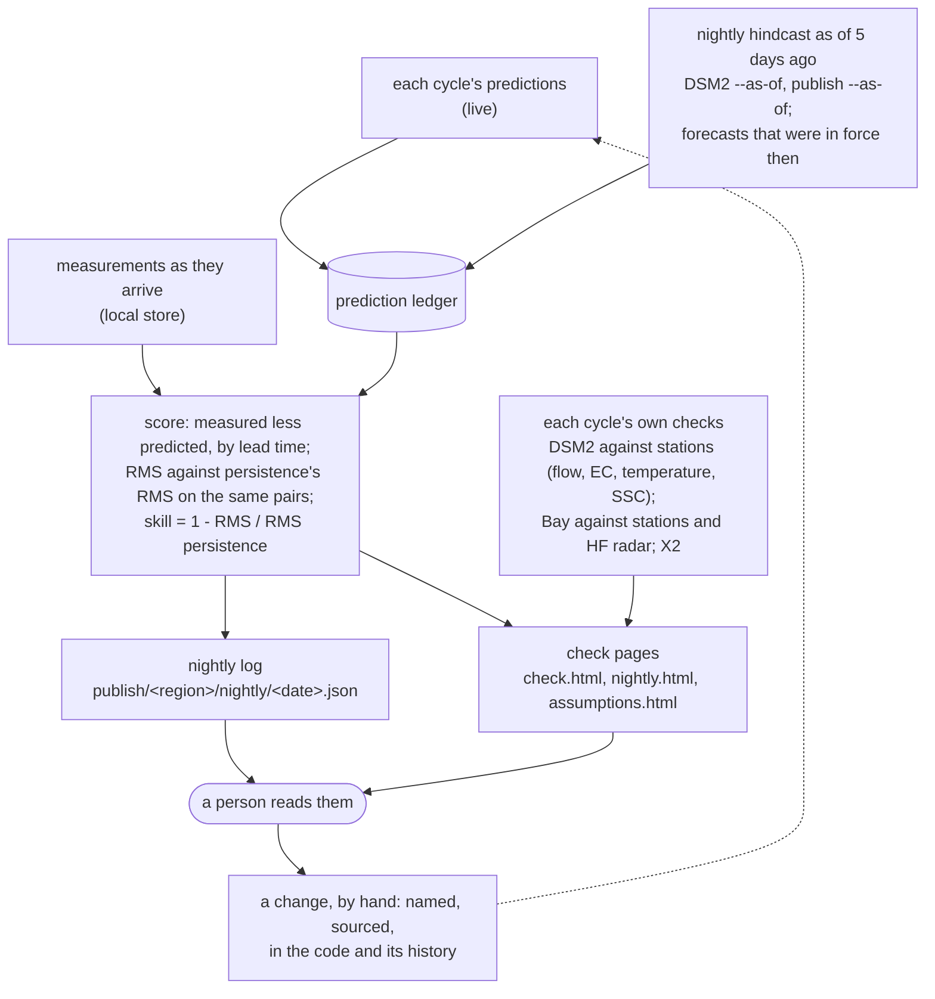
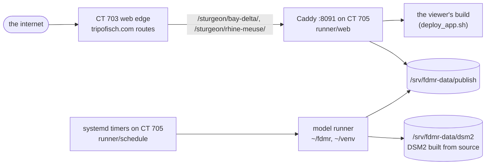

# How it works

How the model gets its data, runs, publishes and checks itself: in block
diagrams first, then in words. Each box names the code that does it, so every
step can be followed to its source. The maths in each kind of water, with its
sources, is in [maths.md](maths.md); every source cited anywhere is in
[references.md](references.md); every assumption the model makes about data it
does not have is published with each cycle and listed on the site's
assumptions page.

## 1. Data flow

From the agencies' services to a visitor's screen. Nothing reaches the screen
that the model runner has not published, and the screen computes nothing
about the water: it moves particles on the flows it is given (specification
4.3, `seams.toml`).

```mermaid
flowchart LR
  subgraph sources["Public data services (references.md, kind data)"]
    direction TB
    g["Gauges and stations<br/>USGS, CDEC, NOAA CO-OPS, NDBC, CeNCOOS"]
    f["Forecasts<br/>CNRFC rivers, NWS weather, NOAA SFBOFS bay"]
    o["Operations<br/>USACE flood control, USBR CVO, DWR reports"]
    s["Satellites and analyses<br/>ECOSTRESS, SMAP, OPERA, SNODAS,<br/>OpenET, NWS precipitation, HF radar"]
    e["Ocean edge<br/>CPC ENSO indices, CoastWatch sea level"]
  end
  a["Adapters<br/>python/fdmr_adapters<br/>one per service, SI units"]
  st[("Local store<br/>store/fdmr.sqlite<br/>every value, its time and source")]
  subgraph runner["Model runner, CT 705 (runner/schedule/cycle.sh)"]
    direction TB
    k["Kinds of water<br/>river routing, 1-D tidal network (DSM2),<br/>canals, 2-D bay (FVCOM)"]
    p["Publish<br/>fdmr_runner.publish"]
  end
  c[("Published cycle<br/>publish/&lt;region&gt;/current<br/>index.json, geometry, .fdf fields,<br/>overlays.json, skill.json")]
  l[("Prediction ledger<br/>store/ledger/&lt;region&gt;.sqlite")]
  w["Web edge, CT 703<br/>tripofisch.com/sturgeon/bay-delta/"]
  u["Viewer in the browser<br/>ui/ (display) and fdmr-compute<br/>(WebAssembly: particles on the flows)"]
  sources --> a --> st --> k --> p --> c --> w --> u
  p --> l
  st --> l
```

## 2. One cycle

What runs, in order, at each cycle. Three timers run `cycle.sh`: hourly (the
rivers), every six hours (adds the Delta, its export canals and the Bay) and
nightly (adds channel measurements, river calibration and the nightly regime).
A cycle that is still running when the next is due makes the next wait.

```mermaid
flowchart TD
  t["systemd timers<br/>hourly / delta every 6 h / nightly 00:05 PST"] --> fe
  fe["fetch<br/>fdmr_runner.fetch: every adapter the region uses;<br/>a failed fetch is named in fetch-status, the rest carry on"] --> n1{nightly?}
  n1 -- yes --> ca["calibrate rivers<br/>fdmr_runner.calibrate: wave travel times<br/>measured between gauges (section 4)"]
  n1 -- no --> d1{delta cycle?}
  ca --> d1
  d1 -- yes --> h["DSM2 HYDRO: flows and levels<br/>fdmr_runner.delta on DWR's study, live inputs"]
  h --> q1["QUAL: salinity (EC)"] --> q2["QUAL: water sources (fingerprints)"] --> q3["QUAL: water temperature on live weather"] --> gt["GTM: suspended sediment<br/>fdmr_plugins.dsm2.sediment"]
  gt --> cn["export canals<br/>fdmr_runner.canals"] --> by["Bay: NOAA SFBOFS, net flow made the Delta's,<br/>carried past 48 h by tides plus outflow, quality corrected<br/>fdmr_runner.bay"]
  d1 -- no --> pu
  by --> pu["publish<br/>rivers routed with their heat budget; every reach joined;<br/>overlays; assumptions; the maths each reach ran;<br/>the sturgeon forecast (fdmr_runner.fishing)"]
  pu --> le["ledger: this cycle's predictions kept"]
  le --> n2{nightly?}
  n2 -- yes --> ni["nightly regime<br/>fdmr_runner.nightly (section 3)"]
  n2 -- no --> done(["current points at the new cycle"])
  ni --> done
```

## 3. Validation

How the model is checked, and how a change to it is made. Every published
prediction is kept, scored when the measurement arrives, and set against
persistence (the last reading, held). Nightly, the model is rerun as of five
days before, with only what was known then. Nothing changes the model by
itself: a person reads the scores and logs, and any change is made by hand,
with its reason, in the code and its history.

## 4. What changes by itself, and what does not

- **Nothing is tuned to the scores.** The ledger and the nightly hindcast
  measure; they never adjust.
- **One thing is refitted nightly from measurements:** each river segment's
  wave travel time and water factor (`fdmr_runner.calibrate`, specification
  9.1), from release changes and tracer signals measured arriving at the next
  gauge. Each night moves the stored value 30% of the way to the night's
  measured estimate (`calibration.blend`), and every night's values, with
  skill before and after, are appended to `calibration/<region>.log.jsonl`.
  It is measurement, not fitting to the score, and it is logged; it is listed
  here so that it is never mistaken for a silent modifier.
- **Every input past its last reading** is carried on in a named way (held,
  held at its 25-hour mean, its own forecast, a release rule) and each
  cycle's `index.json` says which, input by input (`reaches[].assumptions`).

## 5. Where it runs

Both containers are on the webserver host. The model runner touches no other
machine.
