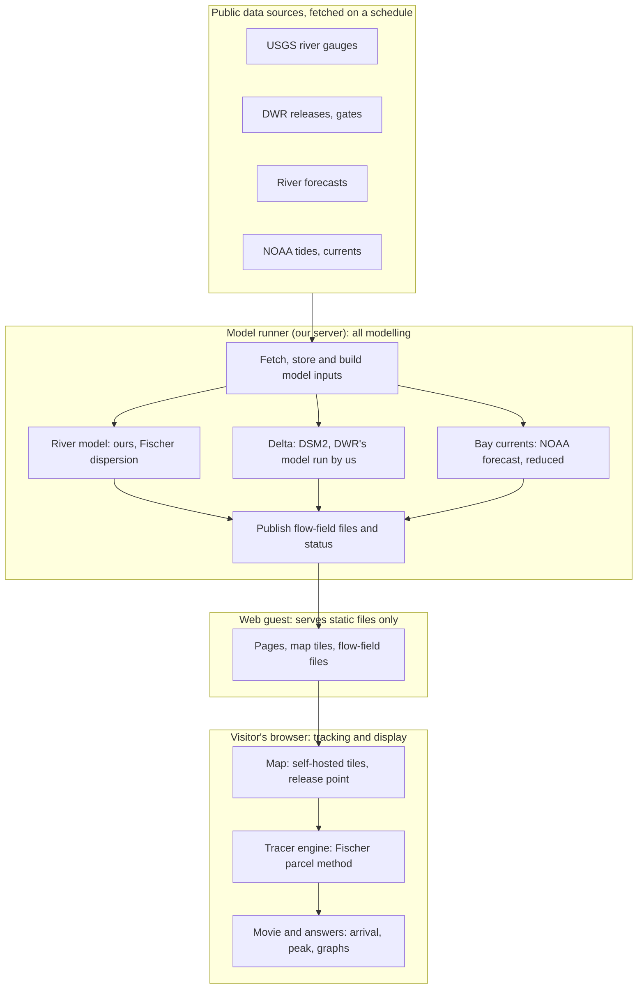

# Fischer Delta Model Returns: User and Engineering Specification

Draft 1 · 24 November 2026

## 1. Summary

Fischer Delta Model Returns is a free web app that shows how water is moving between Shasta Dam and the Golden Gate, now, over the last 14 days and over the next 14, and where a pollutant released anywhere in it will travel. Everything plays as a movie of moving particles on a zoomable map.

It will live under Utilities on tripofisch.com, run entirely on hardware we own, and carry a non-commercial license. The code lives in the FischerDeltaModelReturns repository.

**Decisions already made**

| Topic | Decision |
| --- | --- |
| Extent | Shasta Dam to the Golden Gate |
| Conditions | One timeline: the last 14 days, now, and a 14-day forecast. The past window rolls forward and is always kept up to date; nothing older is replayed |
| Delta engine | DWR's DSM2, run on our server |
| River above Sacramento | Our own routing model using Hugo Fischer's dispersion method |
| Bay below Martinez | NOAA's Bay current forecast, fetched as data; our own tracking on top |
| Data and compute | Fetch public data freely; all modelling and display on our hardware |
| Server | Intel, Debian guests under Proxmox; model runner separate from the web guest |
| Movie length | 14 days back and 14 days forward. The colour fades as certainty fades into the forecast |
| Engine and regions | One engine for any geography: a shared math library, and model kinds picked reach by reach in each region's package. Launch ships one region; the Mississippi, the Thames, the Nile and others are later candidates |
| Display | Moving particles show the water's direction and speed everywhere, always; particles carrying a pollutant take its colour |
| Release locations | Anywhere in the modelled network, including the San Joaquin side of the Delta up to Vernalis |
| Historic layers | After launch |
| Original FORTRAN | Not used; ownership not pursued |
| License | PolyForm Noncommercial 1.0.0 for code, CC BY-NC 4.0 for content |
| Commercial use | None |

**Not yet verified.** Each item below is a Phase 0 task in section 10.

- DSM2 building and running on Debian. DWR supports Linux builds, but one library must be requested from them.
- The exact live feed for every DSM2 boundary input.
- NOAA's Bay forecast: horizon, file sizes, how far back its archive goes, and whether its mesh resolves Suisun Bay up to Chipps Island well enough for the handoff there (section 7.4).
- A public copy of DSM2's map geometry. DWR's documentation points to internal network drives.
- Enough USGS field measurements and conductance records on the river to calibrate water velocity and dispersion.

This is a first draft. Items marked *proposed* are suggestions, not decisions.

## 2. Heritage

Hugo B. Fischer's two main methods are the working core of the app, one in each of the reaches we model ourselves.

| His work | Where it runs in the app |
| --- | --- |
| Longitudinal dispersion in natural streams ([Caltech thesis, 1966](https://thesis.library.caltech.edu/9180)) | The river from Keswick to Sacramento: how a slug of pollutant stretches as it travels |
| Lagrangian parcel tracking (DELSAL, the salt half of the Fischer Delta Model) | The tracer engine everywhere: the pollutant is carried as parcels of water |
| The Fischer Delta Model | The ancestor of DWR's DSM2, which supplies the Delta flows |

**Visible heritage in the product**

- A History section telling the story in words and pictures: the thesis, the 1970s and 1980s Delta studies, the field trips, the punch cards, the Fischer Delta Model, and its line of descent to DSM2.
- After launch: a "1982 view" layer showing his original channel grid, if the published reports yield the geometry.
- After launch: a historical layer of the salinity and velocity measurements collected on the Delta field trips, with dates.
- After launch: scenario presets that reproduce questions he was paid to answer, such as a release at a named outfall.

The original FORTRAN is not used and its ownership is not pursued; the punch cards appear only as photographs. Source material: the family papers and photographs, and the [Hugo B. Fischer papers at UC Riverside](https://public.ucrlib.aspace.cdlib.org/repositories/5/resources/816), which hold the 1982 DELFLO and DELSAL reports.

## 3. User specification

A visitor watches the water move: as it is now, over the last two weeks, or over the next two. They can pick a point on the water, describe what was released, and watch where it goes.

### 3.1 Who it is for

Curious members of the public, students, boaters and anglers, and people who know the Delta. It is an educational tool. It is not for emergency response, permitting or legal use, and every screen says so.

### 3.2 The map

- Opens on the whole system, Shasta Dam to the Golden Gate, with the modelled waterways highlighted.
- Zooms smoothly from the whole system down to a single slough.
- Shows place names, towns, bridges, dams, pumping plants and gauging stations.
- Shows current conditions before any pollutant is added: particles drifting with the water in every reach, showing its direction and speed, and the state of the tide. In the Delta and the Bay the particles visibly turn around with the tide.
- States when the conditions were last updated.

### 3.3 Adding a pollutant

The user presses "Add pollutant" and clicks or taps the water. The point snaps to the nearest modelled channel. A short form then asks:

| Question | Choices | Default |
| --- | --- | --- |
| How is it released? | All at once, or continuously for a set duration | All at once |
| How much? | A mass, or a volume with a concentration | None; required |
| When? | Now, a chosen time in the forecast, or a chosen time in the last 14 days (*proposed*) | Now |
| Does it break down? (*proposed, later*) | No, or a half-life | No |

Version 1 treats the pollutant as dissolved: it moves with the water and does not float, sink or decay. More than one release can be on the map at once (*proposed*).

A release in the past (*proposed*) answers "if something went in three days ago, where is it now, and where is it going?" It plays forward from the past release time through now and on into the forecast.

### 3.4 The timeline and the movie

There is one timeline, from 14 days ago through now to 14 days ahead, and three ways to use it.

| Mode | What it shows | Time |
| --- | --- | --- |
| **Now** (the default on opening) | The water as it is moving at this moment | Stands still at now. The particles keep moving over the current flow, sped up so the motion is visible |
| **Last 14 days** | How the water has actually moved: tides, release changes, storms, pumping | Plays the recent past. Built from measured conditions, so it is shown at full certainty |
| **Next 14 days** | The forecast | Plays forward from now, fading as certainty fades |

- The past window rolls: each day the oldest day drops off and the newest is added, so it is always the last 14 days.
- Particles show the flow in every mode, with or without a pollutant (section 8.4).
- The movie can run straight through, from 14 days ago to 14 days ahead. A "Now" button jumps back to the present at any time.
- With a pollutant, the movie plays forward from the release time.
- Controls: play, pause, speed, and a time slider with the date, the tide state and a "now" mark.
- The plume is drawn as the particles carrying it: the same moving particles that show the flow, coloured by concentration, with a legend. Zoomed out to the whole system, where particles are too small to see, the channels and Bay are coloured instead (section 8.4).
- The leading edge and the peak are marked.
- The forecast runs 14 days. The further ahead, the less certain, and the display shows that: as certainty fades, so does the plume's colour, until a plume far into the forecast is a pale wash over the map. The time slider is shaded the same way, so the user can see where each reach passes from solid forecast into assumption. Section 8 gives the limits for each reach and how certainty is worked out.
- Read-off answers carry the same certainty, in words: an arrival time on day 2 is "forecast", one on day 12 is "rough guide" (*proposed wording*).

### 3.5 Answers the user can read off

- When the pollutant first arrives at a chosen place, when it peaks, and at what concentration.
- A graph of concentration over time at any point the user clicks.
- Arrival times at a fixed list of landmarks, such as the Delta pumping plants, Rio Vista, Martinez and the Golden Gate.

### 3.6 Dam releases

The user can see the current Keswick release and, as a separate tool, try a different release to see the expected change in water level and its arrival time at downstream gauges. This is a second-stage feature.

The tool can also show that the change in water level arrives before the water released with it, since a wave travels faster than the water carrying it (*proposed*). Section 7.1 explains why.

### 3.7 Privacy and operation

- No account and no tracking. What the user enters never leaves their device.
- Works on a phone, tablet or desktop browser.
- If the live data is stale, the app says how old it is and still runs.

### 3.8 Out of scope for version 1

The 1982 grid and all historic layers, oil and other floating spills, sediment-bound or sinking material, chemical reactions, temperature, wind effects on the Bay surface, the San Joaquin River above Vernalis, and any replay older than the rolling 14-day window.

## 4. Engineering: architecture

The server computes where the water is going; the visitor's browser computes where the pollutant goes in that water.

That split is what makes the app interactive and private. The flow field is the same for every visitor, so the server computes it once per cycle and publishes it as static files. A pollutant release is different for every visitor, so it is computed on their device from those files.

Data flows one way, top to bottom. The only thing that crosses from server to browser is a set of static files.

**Server side, on a schedule**

1. Fetch public measurements and forecasts.
2. Build model inputs for the forecast window, and refresh the recent past from the latest measurements.
3. Run the river model and DSM2; read in the NOAA Bay forecast.
4. Convert all three flow fields to one compact published format.
5. Publish the files and a small status file to the web server, and roll the 14-day past window forward.

**Browser side, on demand**

1. Load the map and the flow-field files for the time being shown, starting with now.
2. Take the user's release point and amounts.
3. Track parcels through the flow field in a background thread.
4. Draw the movie and the read-off answers.

Nothing the browser does requires a call back to the server beyond fetching static files, and no third-party server is contacted at all.

### 4.1 One engine, many geographies

Launch has one region, Shasta Dam to the Golden Gate. The engine is built from the start for many: later the Mississippi, the Thames, the Nile and other rivers, estuaries and bays. Two things make that possible: a shared library of math components, and a region package that picks which kind of model runs where.

Sections 5 to 9 describe the launch region. This section says which parts of it are general.

#### Three layers

| Layer | What it is | Changes per region? |
| --- | --- | --- |
| Math library | The equations, each written and tested once | Never |
| Model kinds | Ready-made models built from the library, one for each kind of water | Never; a region picks among them |
| Region package | The network, a model kind for each reach, data feeds, settings and written content | Yes. This is all a new region writes |

#### The math library

The library is pure calculation, with nothing about any place in it. Each component is tested against textbook cases and, where possible, against the launch region.

| Component | Used by |
| --- | --- |
| Longitudinal dispersion, from Fischer's estimate | River routing; 1D tidal network |
| Flood-wave routing, with travel time and attenuation that depend on flow | River routing |
| Hydraulic geometry: fitting area, width, depth and velocity against flow | River calibration |
| Lag and change of shape of a signal between two gauges | Calibrating wave speed, water speed and dispersion |
| Parcel movement: carried by the flow plus a random step for dispersion, in 1D channels and on 2D meshes | Tracer engine, every reach |
| Junction splitting by share of outflow; mixing in pools; capture by sinks | Tracer engine |
| Handing parcels across a line between two reaches | Tracer engine, every join |
| Tidal fit with a river-outflow drift term | Extending a 2D forecast past its end; tide predictions where no official ones exist |
| Certainty: horizons and fade per reach | Every reach; the display |
| Quantising and packing fields into the published format | Publisher |

#### Model kinds

Each reach of a region is one of these kinds. The kind is chosen by the water's physics and by what data exists there.

| Kind | Water it suits | Flow comes from | At launch |
| --- | --- | --- | --- |
| River routing | One-way rivers with flow gauges | Our model, driven by gauges and river forecasts | Shasta Dam to Sacramento |
| 1D tidal network | Tidal rivers and branching channels | A one-dimensional hydrodynamic model we run | The Delta, with DSM2 |
| 2D field | Wide estuaries, bays and lagoons | A fetched forecast, or a two-dimensional model we run | San Francisco Bay, with NOAA's forecast |
| Well-mixed pool | Lakes, reservoirs, forebays, flooded islands | A water balance of inflows and outflows | Keswick Reservoir; DSM2's reservoirs |
| Ocean boundary | Where water leaves the region | Nothing. Parcels past it are counted out | Past the Golden Gate |

Every kind writes the same published format (section 8.3), so the tracer engine and the display never know which kind produced a reach. Within a kind the flow source can be swapped. The launch region's 1D tidal network is DSM2, but nothing outside its adapter assumes that.

**The gap for other regions: a general 1D tidal model.** DSM2 is set up, calibrated and maintained for the Delta. The tidal Thames, the Mississippi below Baton Rouge or another delta would each need a 1D tidal model of its own. There are two routes, to be decided before the second region:

- Set up DSM2, or another open 1D model, on the new network.
- Write our own 1D tidal solver into the math library from the published equations. Fischer's DELFLO was exactly this kind of model, so this would bring back his flow half as well as his transport half. It would be checked against DSM2 in the Delta, where DSM2 is the reference. It must be written from published equations, not from DSM2's source, to stay clear of DSM2's GPL license (section 9.4).

Either way, a new region needs its own channel survey and calibration data, and that is usually the harder part.

#### Picking model kinds for a region

A region package lists its reaches. For each one it names a model kind, a flow source, the data adapters that feed it and its handoffs to neighbouring reaches. A new region is set up by writing that list and gathering its data, not by changing the engine.

The rows below are sketches to show that the same kinds recur. They are not researched; each region would start with its own Phase 0.

| Region | Reaches and kinds |
| --- | --- |
| San Francisco Bay-Delta (launch) | River routing from Shasta Dam to Sacramento; 1D tidal network for the Delta, with DSM2; 2D field for the Bay, from NOAA; pools for Keswick and DSM2's reservoirs |
| Lower Mississippi | River routing above the reach of the tide; 1D tidal network to the passes; 2D field at the mouth, if a NOAA Gulf forecast resolves it |
| Thames | River routing down to Teddington Lock, the tidal limit; 1D tidal network from Teddington through London to the estuary; 2D field for the outer estuary, if a European shelf forecast is fine enough |
| Nile | River routing from the Aswan High Dam through the barrage-controlled delta branches to the Mediterranean, driven by global river forecasts where gauges are sparse |

#### Data adapters, in tiers

| Tier | Examples | Serves |
| --- | --- | --- |
| Regional | CDEC and DWR operations data, California | One region |
| National | USGS gauges, NOAA tides and forecast systems, National Weather Service River Forecast Centers, in the US; the Environment Agency's real-time river and tide data, in England | Every region in that country |
| Global | Copernicus global river-flow forecasts (GloFAS); Copernicus Marine ocean and shelf forecasts; global tide models | Anywhere, as a fallback where national data is thin |

- A region uses the most local tier available for each input. Its certainty settings reflect which tier that is: a reach driven by global forecasts starts less certain than one driven by local gauges.
- Each adapter records its source's license and the attribution it requires, and the region's credits show them.
- A source whose terms forbid our use is not adapted. The global sources' terms are to be checked one by one.
- The fetch-only rule (section 1) holds everywhere: we fetch data, and all modelling runs on our hardware.

#### Place-neutral basics

- **Time:** UTC inside the engine. Each region sets the time zone for display.
- **Units:** SI inside. Each region sets display units: cubic feet per second and miles in the US, cubic metres per second and kilometres elsewhere. The user can switch.
- **Coordinates:** longitude and latitude in published files. Each region names a local projection for its own geometry work.
- **Tides:** tide datums and the names of tide states differ by country; each region supplies its own.
- **Language** (*proposed*): interface text is kept apart from code, so a region can be translated later.

**Keeping it honest** (*proposed*). Nothing place-specific may appear in the engine's code: no station numbers, channel numbers, place names or coordinates. To test this, a second, small region is built alongside the first: a single gauged river somewhere else, using only the river model and national adapters. It runs in the test suite from Phase 1. If the engine needs changing to run it, something regional leaked into the engine.

**Serving several regions** (*after version 1*). Each region publishes its own flow-field set. The browser loads a short list of regions and opens the one chosen. A region can run on its own model runner, so adding one does not slow another.

## 5. Engineering: the map

The map is OpenStreetMap data served from our own server as a single file, drawn in the browser by an open-source renderer, with our own waterway geometry on top.

### 5.1 Base map

| Piece | Choice (*proposed*) | Why |
| --- | --- | --- |
| Renderer | [MapLibre GL JS](https://maplibre.org/) | Open source, smooth zoom, runs entirely in the browser |
| Map data | [Protomaps](https://protomaps.com/) basemap built from OpenStreetMap | Free, and one file with no tile server to run |
| Delivery | A regional extract in PMTiles format on our web server | The browser reads only the byte ranges it needs |
| Fonts and icons | Copied to our server | The default examples load these from third parties, which we do not allow |

The extract covers Northern California from Shasta Lake to the coast. The whole-planet file is about 100 GB; a regional cut should be a small fraction of that, to be measured.

An aerial imagery option is deferred. Free imagery exists but is large to self-host.

### 5.2 Waterway geometry

The modelled waterways are drawn as our own layer, because the plume must follow the model's channels exactly.

| Reach | Geometry source | Status |
| --- | --- | --- |
| Shasta to Sacramento | USGS national hydrography river centreline, measured in river miles | Source to confirm |
| Delta | DSM2 channel centrelines and nodes. [DWR's documentation](https://github.com/CADWRDeltaModeling/dsm2) describes shapefiles of these, but on internal drives | Ask DWR, or rebuild from the published channel inputs |
| Bay | The NOAA Bay model's mesh, about 54,000 nodes, for placing currents; OpenStreetMap shoreline for drawing | To confirm |

Each Delta channel on the map carries its DSM2 channel number, so a click maps directly to a model location.

### 5.3 Reference layers

Gauging stations with live readings, dams, pumping plants, gates and barriers with their current state, and named landmarks used for arrival times.

## 6. Engineering: live data feeds

Every input comes from a free public source; three of the seven have been checked and four still need checking.

| Input | Source | Used by | Status |
| --- | --- | --- | --- |
| River flow and stage at gauges, Keswick to Freeport | [USGS Water Data APIs](https://api.waterdata.usgs.gov/docs/ogcapi/migration/) | River model, calibration | Checked. Build on the new API only: the old WaterServices shuts down in February 2027 |
| Field measurements at river gauges: area, width, mean velocity | USGS Water Data APIs | River velocity and channel shape (section 9.1) | To confirm the new API serves them, and how often each gauge is measured |
| Specific conductance and water temperature at river gauges | USGS Water Data APIs | River tracer calibration (section 9.1) | To confirm which gauges record them continuously |
| Keswick and Shasta releases, Delta exports, gate positions | California Data Exchange Center (DWR) | River model, DSM2 | To confirm station by station |
| River flow forecasts | [River Forecast Center hourly CSV files](https://www.cnrfc.noaa.gov/deterministicHourlyProductCSV.php), by forecast group | River model, DSM2 inflows | Checked. Upper and Lower Sacramento groups are published; about 5 days ahead |
| Tide at Martinez, observed and predicted | NOAA tide stations | DSM2 seaward boundary | To confirm station and format |
| Bay currents, nowcast and forecast | [NOAA San Francisco Bay Operational Forecast System](https://tidesandcurrents.noaa.gov/ofs/sfbofs/sfbofs_info.html), NetCDF files | Bay reach | Checked. Four runs a day; grid covers Suisun Bay to the ocean. Horizon believed to be about 48 hours, to confirm |

### 6.1 What DSM2 needs

DSM2 has a documented forecasting mode that fits this job. It uses recent field data for current conditions, extends the Martinez tide with an astronomical forecast, and projects the Delta one to ten weeks ahead.

Its boundary inputs, from DWR's own checklist, are:

- Sacramento River inflow, with the Yolo Bypass
- San Joaquin River inflow
- Smaller eastside inflows
- Banks and Jones export pumping, and smaller diversions
- Delta island consumptive use, taken as DWR's average values
- Gate and barrier operations
- Stage at Martinez

DSM2 reads these from the Army Corps' DSS time-series format. Converting our fetched data into that format is the main piece of glue code on the server.

### 6.2 Fetching rules

- Fetch hourly for gauges, and on each new cycle for forecasts.
- Keep every fetched value in a local store, so a source outage degrades the forecast instead of stopping it.
- Record the time and source of every value, and publish the age of the data with the flow field.
- Be a polite client: identify ourselves, cache, and never fetch more often than the source updates.

## 7. Engineering: the three reach models

Each reach produces the same thing, water velocity along its waterways over time, by the method that suits its physics.

| | River | Delta | Bay |
| --- | --- | --- | --- |
| Extent | Shasta Dam to Sacramento | Sacramento and Vernalis to Chipps Island, with Suisun Marsh (*proposed*) | Chipps Island to the Golden Gate, with Suisun Bay (*proposed*) |
| Character | One-way river flow | Tidal, branching channels | Wide tidal bays |
| Flow source | Our routing model | DSM2 HYDRO, forecast mode | NOAA Bay forecast, fetched |
| Who does the math | Us | Us, running DWR's code | NOAA for currents, us for tracking |
| Calibration | Automated, ours | Done by DWR | Not needed |

### 7.1 River: Shasta Dam to Sacramento

**Structure.** The river is a chain of segments between gauges. Keswick Reservoir, between Shasta and Keswick dams, is a single mixed pool. The Keswick release drives everything below it. Tributary inflows are added where they join, taken from gauges; the largest, the Feather and the American, join just above Sacramento.

**Two speeds.** The river carries two different things at two different speeds, and the model keeps them apart.

| | A change in flow | A pollutant |
| --- | --- | --- |
| Travels as | A wave | Part of the water |
| Speed | Wave speed (celerity) | Mean water velocity: flow divided by cross-section area |
| Drives | Flow and stage at the gauges; the dam-release tool | The movie |
| Calibrated from | Release changes arriving at gauges | USGS field measurements and natural tracers (section 9.1) |

The wave is faster than the water. In a wide channel, theory puts it at about one and a half to one and two-thirds times the water velocity; each segment's ratio is measured, not assumed. A pollutant released at the same moment as a change in release arrives downstream later than the change in water level. Using one speed for both would make every pollutant arrival time too early.

**Flow routing.** Changes in release travel downstream as a wave. Each segment has a wave travel time and an attenuation that depend on flow.

**Water velocity and channel shape.** Each segment has a relation between flow and its cross-section area, width and depth, and so its mean water velocity. These start from the measurements USGS makes at each gauge, and are corrected toward the reach average by the tracer checks in section 9.1, because a gauge site is not a typical cross-section.

**Pollutant transport.** Within each segment the pollutant moves at the mean water velocity and spreads along the river by longitudinal dispersion. The dispersion coefficient starts from Fischer's estimate, K = 0.011 U²W² / (d u\*), where U is mean velocity, W width, d mean depth and u\* shear velocity, all taken from the segment's channel shape at the current flow. The estimate is known to be good only to within a factor of several, which is why section 9.1 checks it against the river's own tracers.

**Water levels from releases.** Routed flow at each gauge is converted to stage with that gauge's published rating curve. This gives the dam-release tool in the user specification.

**Known complications.**

- In floods the river spills over weirs into the Sutter and Yolo bypasses. Version 1 detects this from gauges and warns that the forecast is unreliable (*proposed*).
- Large diversions remove water and pollutant in irrigation season. They are represented where gauged.
- Pools, eddies and backwaters hold some water back and let it go slowly, which gives a real plume a longer tail than the dispersion model produces. Version 1 does not model this; the tracer checks in section 9.1 show how large the error is.

### 7.2 Delta: Sacramento to Chipps Island

DSM2's HYDRO module runs on our server in forecast mode and writes flow and stage for every channel through the forecast window. We use HYDRO only. DSM2's own transport modules are batch tools, and our interactive tracking replaces them, so they serve as a check on our engine instead.

The whole DSM2 network is open for releases, including the San Joaquin side and the south Delta up to Vernalis, and the Suisun Marsh sloughs. That makes the San Joaquin inflow and its forecast a required feed, not an optional one.

DSM2 still runs its full network to Martinez, because its seaward boundary is the Martinez tide. Its channels seaward of Chipps Island are not used for tracking; they are kept as an overlap with the Bay model, to check one against the other (section 7.4).

A run covers a warm-up period of recent days, so the model starts from realistic conditions, followed by the forecast.

### 7.3 Bay: Chipps Island to the Golden Gate

NOAA's forecast gives currents on a triangular mesh at hourly steps. The server reduces these to depth-averaged currents on a lighter mesh for the browser.

Beyond the end of NOAA's forecast, the server extends the currents with a fit made from the archive of past NOAA fields (*proposed*). At each mesh point the fit has two parts: the tides, and a net seaward drift that grows with Delta outflow. The extension uses DSM2's forecast outflow at Chipps Island, so the Bay and the Delta agree on how much river water is leaving. In Suisun Bay that drift matters as much as the tide, which is why a tides-only extension is not enough. The extension is our own calculation and does not include wind.

A tidal fit needs at least a month of past fields to separate the main tides, and a year to do it well. The archive must be in hand before Phase 3: either NOAA's public archive goes back far enough, or we start saving the forecasts ourselves now.

### 7.4 Joining the reaches

- **River to Delta** at the Sacramento River inflow point of DSM2. The river model's outflow and pollutant load become the Delta's inflow.
- **Delta to Bay** at Chipps Island (*proposed*), detailed below.
- All three share one clock and one published time step.

**Why Chipps Island and not Martinez.** Both DSM2 and NOAA cover Suisun Bay, so one has to govern it.

- Suisun Bay is a wide, shallow bay with side bays and shoals. DSM2 represents it as a few one-dimensional channels, so a plume there could not spread sideways across the shoals into Grizzly and Honker bays. NOAA's two-dimensional mesh can show that.
- A model is least reliable near its own boundary. Martinez is DSM2's seaward boundary, where its water simply arrives from or leaves to "the ocean". At Chipps Island, DSM2 is well inside its network.
- Chipps Island is already the Delta's standard reference point: Delta outflow and the salinity line known as X2 are both reckoned there.

**The handoff line.** A line across the estuary at Chipps Island, from the Suisun Marsh shore to Mallard Island, split into segments, one for each DSM2 channel it crosses. The Suisun Marsh sloughs stay with DSM2, because DSM2 models the Montezuma Slough salinity control gates, so the line also takes in each point where a marsh slough opens into Suisun Bay. The exact points are set from both grids in Phase 3.

**Crossing the line.**

- Each parcel belongs to exactly one engine at a time, so nothing is counted twice.
- A parcel leaving a DSM2 channel seaward enters the Bay mesh on that channel's segment of the line, placed across it in proportion to the local flow.
- A Bay parcel crossing the line landward enters the DSM2 channel that owns that segment.
- Parcels cross in both directions with every tide. The method conserves mass whatever the two models do.

**The overlap.** The two models are forced separately, so their flows across the line will not match exactly. Between Chipps Island and Martinez both run, and the server compares their tidal and net flows each cycle and publishes the difference. A persistent mismatch shows up as parcels piling up or thinning out at the line; how large a mismatch is acceptable is set during Phase 3.

**Fallback.** If Phase 0 finds NOAA's mesh too coarse in Suisun Bay, or not reaching Chipps Island, the handoff moves to Martinez, and Suisun Bay is tracked in DSM2's channels with the sideways-spreading limit above noted on screen.

## 8. Engineering: tracer engine, forecast and display

The pollutant is carried as thousands of parcels, each holding a share of the released mass, moved through the published flow field in the browser.

### 8.1 Tracer engine

- **Release.** An instant release creates all parcels at once. A continuous release creates them steadily over its duration.
- **Movement.** Each time step, a parcel moves with the local velocity plus a random step that represents dispersion.
- **Junctions.** At a channel junction a parcel takes an outgoing channel with probability proportional to that channel's share of the outflow.
- **Losses.** A parcel drawn into an export pump or diversion leaves the system and is counted.
- **Concentration.** Mass in the parcels within a stretch of channel, divided by the water volume of that stretch.
- **Mass balance.** Released mass equals mass in the water plus mass exported plus mass past the Golden Gate, checked every step.

The engine runs in a background thread so the map stays responsive. Parcel count is set by device capability (*proposed*: about 20,000 on a phone, more on a desktop).

### 8.2 Forecast horizon

| Reach | Solid forecast | Beyond that |
| --- | --- | --- |
| River | About 5 days, from published flow forecasts | Assume the last forecast flow persists |
| Delta | Tides for all 14 days. Inflows as far as the river forecasts, about 5 days; exports and gates as far as their published schedules. DSM2 can run ten weeks, but its inputs cannot | Inflows, exports and gates held at their last known values |
| Bay | To the end of NOAA's forecast | Our extension: tides plus outflow drift, no wind (section 7.3) |

Movie length: 14 days, with uncertainty shown growing along the timeline. Water from Keswick takes several days to reach the Delta, so upstream releases need most of that window.

**Certainty** (*proposed method*). Every reach has a certainty value at every published time step, from 1 down toward 0.

- Inside a reach's solid forecast, certainty is 1.
- Past it, certainty falls steadily to a floor at day 14. The rate and floor are set per reach; to start, every reach falls to 0.2.
- Once the river and Bay skill records (sections 9.1 and 9.2) are long enough, the rates are set from how far past forecasts actually drifted at each lead time, rather than by hand.
- Each parcel carries its own certainty: the lowest value it has passed through. A parcel moved by assumed flow stays uncertain, even if it later enters a reach that is still inside its solid forecast.
- The colour of a stretch of channel or patch of Bay is faded by the certainty of the parcels in it, weighted by their mass.

This is certainty about the flow, not a statistical confidence. It does not cover errors in the models themselves inside the solid forecast, or in what the user entered.

**Later: real spread** (*proposed, after launch*). The River Forecast Center also publishes ensemble flow forecasts, many possible futures rather than one. Running the river and DSM2 once per ensemble member would give real spread: a plume drawn from all of them, faded where they disagree. That multiplies the server's work and the published files, so it waits until the single forecast works.

### 8.3 Published flow-field format

- One small index file: time range, time step, data age per source, model status, and each reach's certainty at each time step.
- Binary files per reach per day, holding velocity and water volume per channel segment or mesh node per time step, quantised to keep them small. The browser fetches only the days it is about to play, so opening on "Now" loads one day, not 28.
- The timeline holds 28 days: 14 past, 14 forecast.
- **Past days** are built from measured conditions: the river model driven by observed gauges, DSM2's warm-up period on observed inputs, and NOAA's nowcasts. Measurements arrive late and are revised, so the last two days of the past are rebuilt each cycle. Older past days are final; they never change, and browsers can cache them.
- **Forecast days** are rebuilt every cycle.
- Each day ends with the river and DSM2 states needed to start the next, so the past and forecast join without a jump at "now".
- Rough sizes, to be measured: the Delta is a few megabytes for two weeks; the Bay is the largest and may need coarsening. The past window doubles the total held, but not what a visitor downloads.
- The index file and the forecast days are replaced as a set, so a browser never mixes two cycles.

### 8.4 Display

The water is always shown moving: particles drift along every river, channel and slough and across the Bay, showing which way the water is going and how fast. When a pollutant is added, the particles carrying it take on its colour, and that colour fades as certainty fades.

**Flow particles, always on.**

- Small dots with short trailing streaks, moving with the water in the published flow field. Direction is the direction of travel; speed shows as how fast they move and how long their streaks are.
- In the channels they move along the channel and spread across its width when zoomed in far enough to see it. In the Bay they move in two dimensions.
- They are a neutral colour, so they read as "water" and leave every colour free for the pollutant.
- The tide is visible: in the Delta and the Bay the particles slow, stop and turn around with each tide.
- They run before any release, so the map always shows current conditions (section 3.2), and they keep running through the movie at the movie's speed.
- They are spread evenly through the water and kept at a steady density, so empty or crowded patches mean nothing. They are for showing the flow only and carry no mass.

**Pollutant particles.**

- The tracer engine's parcels (section 8.1) are drawn as particles in the same style, so the pollutant is visibly carried by the same water the flow particles show.
- Each is coloured by the concentration where it is, the stretch of channel or patch of Bay around it, not by its own share of mass. This keeps the colour smooth across the plume.
- Concentration uses a logarithmic scale, since concentrations span many orders of magnitude.
- Certainty fades the colour back toward the neutral flow-particle colour. Far into the forecast the plume becomes a pale tint on the moving water rather than a bright cloud.
- The palette is chosen so that its low end is still a strong colour and never pale. A faded high concentration must not look like a low concentration, so fading and concentration stay distinguishable.
- The legend shows both: concentration across, certainty down.

**Zoom.**

- At the whole-system view, Shasta to the Golden Gate, particles would be smaller than a pixel. There, each channel is drawn as a line coloured by concentration and faded by certainty, and the Bay as a shaded field, with the particles faded out.
- Zooming in hands over smoothly from lines to particles. The zoom level where this happens is tuned in Phase 4.

**Rendering and other details.**

- Particle positions are computed in the background thread with the tracer engine. They are drawn by the graphics hardware through a custom map layer, so tens of thousands of particles stay smooth on a phone.
- The number of flow particles drawn is set by device capability, like the parcel count.
- The time slider drives the particles, the plume and the tide indicator together.
- Colours are chosen to work for colour-blind users and in both light and dark map styles.

## 9. Engineering: calibration, validation, deployment, licensing

Only the river model needs calibrating, and it calibrates itself from data the river already produces.

### 9.1 Automated river calibration

The river model has three sets of parameters, each calibrated from a different kind of evidence. Keeping them apart is the point: the wave outruns the water (section 7.1), so evidence about one says nothing direct about the other.

| Parameters | Used for | Calibrated from |
| --- | --- | --- |
| Wave travel time and attenuation | Flow and stage forecasts; the dam-release tool | Keswick release changes arriving at downstream gauges |
| Water velocity and channel shape | Pollutant travel time; the inputs to Fischer's estimate | USGS field measurements at each gauge, corrected by natural tracers |
| Dispersion | How fast the plume spreads | Fischer's estimate, checked against natural tracers |

- **Wave travel time.** Every change in Keswick release is a natural experiment. The server detects the change, finds its arrival at each downstream gauge, and updates the flow-to-wave-travel-time relation for each segment. How a sharp release change smooths out on the way down calibrates the wave's attenuation. Neither is used for pollutant travel or spreading.
- **Water velocity and channel shape.** Several times a year USGS measures each gauge's flow by hand, recording cross-section area, width and mean velocity. Fitting these against flow gives velocity, width and depth at any flow, at each gauge. New measurements are picked up as USGS publishes them.
- **Natural tracers.** Specific conductance and water temperature, where gauges record them, carry signals that move with the water: a pulse of tributary or drainage water, or a step in release temperature from Shasta's temperature control. When a signal passes two gauges, the lag between them gives the reach-average water travel time, which corrects the gauge-site velocity toward the reach average. The change in the signal's shape gives dispersion. Conductance is the better tracer; temperature is not conserved, since the river warms and cools along the way, so it is used for timing only.
- **Published studies** (*proposed*). Look for past time-of-travel or dye studies on the Sacramento below Keswick, and use any found as a one-off check on velocity and dispersion.
- **Schedule.** Recalibration runs nightly. Parameters change slowly and are logged, so a bad night's data cannot swing the model.
- **Skill scores.** Two, kept separate and published: predicted against observed arrival of flow changes, which scores the wave; and predicted against observed lag of tracer signals, which scores pollutant travel.

### 9.2 Validation

| What | Checked against |
| --- | --- |
| River flow and stage forecasts | Observed flow and stage at the gauges |
| River pollutant travel time and spreading | Natural tracer signals between gauges; any published time-of-travel studies |
| DSM2 flows from our run | Observed flows at DWR's check stations, such as Rio Vista |
| Our tracer engine in the Delta | DSM2's own transport modules on the same flow field |
| Our tracer engine overall | Measured conductivity, which is a natural tracer of seawater |
| Bay extension, tides and outflow drift | Later NOAA forecasts for the same hours |
| Delta to Bay handoff | DSM2 against NOAA flows across the Chipps Island line, and through the overlap to Martinez, every cycle |
| Certainty fade rates | How far past forecasts drifted from the past window that replaced them |
| Mass balance | Exact, every run |

### 9.3 Deployment

- **Model runner**: its own Debian guest on Proxmox, holding the data fetchers, DSM2, the compilers and the scheduled jobs. Compute and serving stay separate: the web guest only serves pages and files, and no model code is installed on it.
- **Web**: static files under Utilities on tripofisch.com. The model runner pushes each finished set of files to the web guest; the web guest never reaches into the model runner. The push method is to be chosen to fit how the site is deployed today.
- **Cadence** (*proposed*): gauges hourly; river model hourly; DSM2 every 6 hours, matching NOAA's four Bay cycles a day.
- **Failure behaviour**: if a run fails, the last good flow field stays published and the status file says how old it is.
- **Interim**: until the Linux build of DSM2 works, DWR's prebuilt Windows release runs in a Windows guest.

### 9.4 Licensing and credit

- **Our code**: PolyForm Noncommercial 1.0.0 for the software, and Creative Commons BY-NC 4.0 for the written and heritage content. None of the data sources requires GPL for our code, because DSM2 runs as a separate, unmodified program.
- **DSM2**: GNU GPL version 3 or later. We run it unmodified and do not redistribute it. Any code of ours that copies or modifies DSM2 source would have to be GPL, and GPL cannot carry a non-commercial restriction, so we keep the two strictly apart.
- **DWR data**: credited as the source; DWR's terms bar commercial redistribution.
- **USGS and NOAA data**: US government public data, credited.
- **Map**: OpenStreetMap data under the Open Database License, with the required attribution on the map.
- **Disclaimer** on every screen: educational model, not for emergency or regulatory use.

This section is not legal advice; the license choice deserves a second look before launch.

## 10. Build phases and open questions

The build runs in six phases, each ending in something that can be seen working; Phase 0 retires the risks before any map is drawn.

1. **Phase 0, proof.** Run DWR's prebuilt DSM2 in a Windows guest. Feed it today's conditions and get a forecast flow field out. Confirm every data feed in section 6. Email DWR for the Linux library and the grid geometry.
2. **Phase 1, the river.** River routing model with automated calibration of both speeds, wave and water, shown on the map from Shasta Dam to Sacramento. First working pollutant movie. This phase is entirely our own code and Fischer's method. The math library, the model kinds and the region package (section 4.1) are set up here, with the small test region beside the real one.
3. **Phase 2, the Delta.** DSM2 on a schedule, flow-field publishing, and parcel tracking through the channel network. River and Delta joined.
4. **Phase 3, the Bay.** NOAA currents, two-dimensional tracking, the extension with outflow drift, and the handoff at Chipps Island.
5. **Phase 4, product.** Read-off answers, landmarks, the dam-release tool, the History section, phone layout, and the Utilities page on tripofisch.com.
6. **Phase 5, hardening.** Native Linux DSM2, validation report, monitoring, and license and credits review. Launch follows this phase. The 1982 grid, the field-data layer and the historic scenario presets are a post-launch release.

### Decisions log, 24 November 2026

- License: PolyForm Noncommercial 1.0.0 for code, CC BY-NC 4.0 for content. See section 9.4.
- The model runner is its own Proxmox guest; the web guest only serves. See section 9.3.
- Movie length is 14 days, with growing uncertainty shown. See sections 3.4 and 8.2.
- The 1982 grid and all historic layers come after launch.
- The punch cards are not read. The app does not depend on the original code or on any claim to it. A History section will hold pictures.
- The San Joaquin side of the Delta is in scope as a release location, up to DSM2's boundary at Vernalis. The river above Vernalis stays out.
- This document is kept in the repository's docs folder.
- River calibration keeps wave speed and water speed apart. Release changes calibrate flow routing only; pollutant travel and spreading come from USGS field measurements and natural tracers. See sections 7.1 and 9.1.
- One timeline: the last 14 days, now, and the next 14 days. The past window rolls forward and is kept up to date. "Now" is the opening view. See section 3.4.
- Moving particles show the flow everywhere, always. Particles carrying a pollutant take its colour, and the colour fades as certainty fades. See sections 3.4, 8.2 and 8.4.
- The engine is built to serve any geography. Its math is a shared library written once; each region's package picks a model kind for each reach (river routing, 1D tidal network, 2D field, pool, ocean boundary) and its data feeds. Launch ships Shasta Dam to the Golden Gate; other estuaries and rivers follow. See section 4.1.
- Proposed, awaiting decision: the Delta-to-Bay handoff at Chipps Island rather than Martinez, with Martinez as the fallback. See section 7.4.

### Open technical questions, answered in Phase 0

- Does DSM2's forecast mode run cleanly from a script, and how long does one run take?
- What is the real forecast horizon and file size of NOAA's Bay product?
- Is DSM2's channel geometry available outside DWR's network?
- Which stations give each export, gate and inflow value in near real time?
- Which river gauges have field measurements, conductance and temperature records long enough to calibrate water velocity and dispersion? Are there published time-of-travel or dye studies on the Sacramento?
- How far back does NOAA's public archive of Bay forecasts go? If it is short, start saving them ourselves at once, for the Bay extension's fit.

### After launch: before the second region

- A general 1D tidal model: DSM2 or another open model set up on the new network, or our own solver in the math library (section 4.1)?
- Which region comes second, judged by how much public data it has and whether a 2D forecast already covers its estuary?

## Sources

- [DSM2 source, build guide and documentation](https://github.com/CADWRDeltaModeling/dsm2), read 24 November 2026
- [DSM2 at the Department of Water Resources](https://water.ca.gov/Library/Modeling-and-Analysis/Bay-Delta-Region-models-and-tools/Delta-Simulation-Model-II)
- [NOAA San Francisco Bay Operational Forecast System](https://tidesandcurrents.noaa.gov/ofs/sfbofs/sfbofs_info.html)
- [NOAA forecast system data on AWS](https://docs.opendata.aws/noaa-ofs-pds/readme.html)
- [USGS Water Data APIs migration guide](https://api.waterdata.usgs.gov/docs/ogcapi/migration/)
- [California Nevada River Forecast Center hourly forecast files](https://www.cnrfc.noaa.gov/deterministicHourlyProductCSV.php)
- [Protomaps](https://protomaps.com/)
- [Hugo B. Fischer papers, UC Riverside](https://public.ucrlib.aspace.cdlib.org/repositories/5/resources/816)
- [Fischer, Longitudinal Dispersion in Laboratory and Natural Streams, Caltech 1966](https://thesis.library.caltech.edu/9180)
- Fischer, List, Koh, Imberger and Brooks, *Mixing in Inland and Coastal Waters*, Academic Press 1979: the source of the dispersion estimate in section 7.1. Citation from memory, to check against the book.

The NOAA, USGS and River Forecast Center entries were checked from search results, not read in full; Phase 0 reads each one properly.
