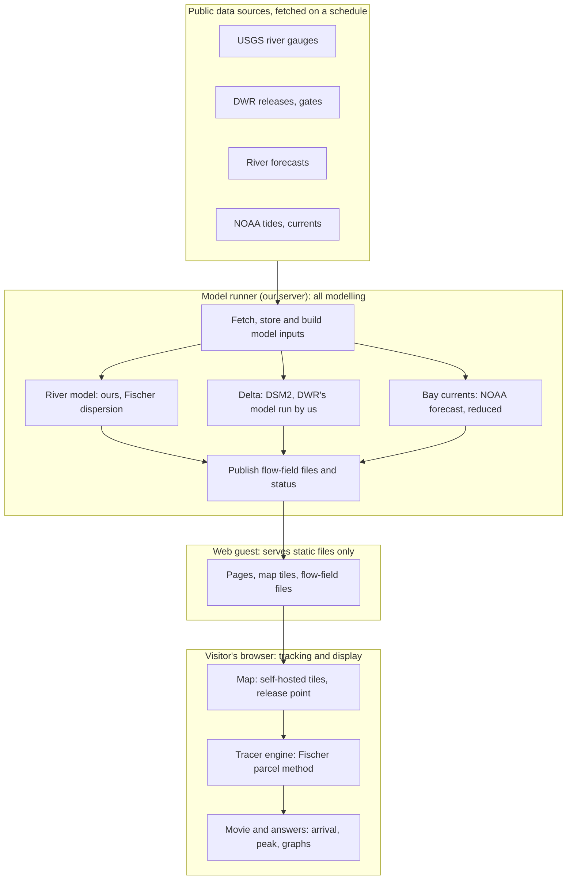

# Fischer Delta Model Returns: User and Engineering Specification

Draft 1 · 24 November 2026

## 1. Summary

Fischer Delta Model Returns is a free web app that shows where a pollutant released anywhere between Shasta Dam and the Golden Gate will travel, starting from current river and tide conditions and running forward as a forecast movie on a zoomable map.

It will live under Utilities on tripofisch.com, run entirely on hardware we own, and carry a non-commercial license. The code lives in the FischerDeltaModelReturns repository.

**Decisions already made**

| Topic | Decision |
| --- | --- |
| Extent | Shasta Dam to the Golden Gate |
| Conditions | Current, with a forecast from now; no historical replay |
| Delta engine | DWR's DSM2, run on our server |
| River above Sacramento | Our own routing model using Hugo Fischer's dispersion method |
| Bay below Martinez | NOAA's Bay current forecast, fetched as data; our own tracking on top |
| Data and compute | Fetch public data freely; all modelling and display on our hardware |
| Server | Intel, Debian guests under Proxmox; model runner separate from the web guest |
| Movie length | 14 days, with growing uncertainty shown |
| Release locations | Anywhere in the modelled network, including the San Joaquin side of the Delta up to Vernalis |
| Historic layers | After launch |
| Original FORTRAN | Not used; ownership not pursued |
| License | PolyForm Noncommercial 1.0.0 for code, CC BY-NC 4.0 for content |
| Commercial use | None |

**Not yet verified.** Each item below is a Phase 0 task in section 10.

- DSM2 building and running on Debian. DWR supports Linux builds, but one library must be requested from them.
- The exact live feed for every DSM2 boundary input.
- NOAA's Bay forecast: horizon, coverage near Martinez, and file sizes.
- A public copy of DSM2's map geometry. DWR's documentation points to internal network drives.

This is a first draft. Items marked *proposed* are suggestions, not decisions.

## 2. Heritage

Hugo B. Fischer's two main methods are the working core of the app, one in each of the reaches we model ourselves.

| His work | Where it runs in the app |
| --- | --- |
| Longitudinal dispersion in natural streams ([Caltech thesis, 1966](https://thesis.library.caltech.edu/9180)) | The river from Keswick to Sacramento: how a slug of pollutant stretches as it travels |
| Lagrangian parcel tracking (DELSAL, the salt half of the Fischer Delta Model) | The tracer engine everywhere: the pollutant is carried as parcels of water |
| The Fischer Delta Model | The ancestor of DWR's DSM2, which supplies the Delta flows |

**Visible heritage in the product**

- A History section telling the story in words and pictures: the thesis, the 1970s and 1980s Delta studies, the field trips, the punch cards, the Fischer Delta Model, and its line of descent to DSM2.
- After launch: a "1982 view" layer showing his original channel grid, if the published reports yield the geometry.
- After launch: a historical layer of the salinity and velocity measurements collected on the Delta field trips, with dates.
- After launch: scenario presets that reproduce questions he was paid to answer, such as a release at a named outfall.

The original FORTRAN is not used and its ownership is not pursued; the punch cards appear only as photographs. Source material: the family papers and photographs, and the [Hugo B. Fischer papers at UC Riverside](https://public.ucrlib.aspace.cdlib.org/repositories/5/resources/816), which hold the 1982 DELFLO and DELSAL reports.

## 3. User specification

A visitor picks a point on the water, describes what was released, and watches a movie of where it goes from now forward.

### 3.1 Who it is for

Curious members of the public, students, boaters and anglers, and people who know the Delta. It is an educational tool. It is not for emergency response, permitting or legal use, and every screen says so.

### 3.2 The map

- Opens on the whole system, Shasta Dam to the Golden Gate, with the modelled waterways highlighted.
- Zooms smoothly from the whole system down to a single slough.
- Shows place names, towns, bridges, dams, pumping plants and gauging stations.
- Shows current conditions before any pollutant is added: flow direction and speed in each reach, and the state of the tide.
- States when the conditions were last updated.

### 3.3 Adding a pollutant

The user presses "Add pollutant" and clicks or taps the water. The point snaps to the nearest modelled channel. A short form then asks:

| Question | Choices | Default |
| --- | --- | --- |
| How is it released? | All at once, or continuously for a set duration | All at once |
| How much? | A mass, or a volume with a concentration | None; required |
| When? | Now, or a chosen time in the forecast window | Now |
| Does it break down? (*proposed, later*) | No, or a half-life | No |

Version 1 treats the pollutant as dissolved: it moves with the water and does not float, sink or decay. More than one release can be on the map at once (*proposed*).

### 3.4 The movie

- Plays forward from the release time, overlaid on the map.
- Controls: play, pause, speed, and a time slider with the date and the tide state.
- The plume is drawn as colour along the channels and across the Bay, graded by concentration, with a legend.
- The leading edge and the peak are marked.
- The movie runs 14 days. The further ahead, the less certain, and the display shows that: the plume edge softens and the time slider is marked where each reach passes from solid forecast into assumption. Section 8 gives the limits for each reach.

### 3.5 Answers the user can read off

- When the pollutant first arrives at a chosen place, when it peaks, and at what concentration.
- A graph of concentration over time at any point the user clicks.
- Arrival times at a fixed list of landmarks, such as the Delta pumping plants, Rio Vista, Martinez and the Golden Gate.

### 3.6 Dam releases

The user can see the current Keswick release and, as a separate tool, try a different release to see the expected change in water level and its arrival time at downstream gauges. This is a second-stage feature.

### 3.7 Privacy and operation

- No account and no tracking. What the user enters never leaves their device.
- Works on a phone, tablet or desktop browser.
- If the live data is stale, the app says how old it is and still runs.

### 3.8 Out of scope for version 1

The 1982 grid and all historic layers, oil and other floating spills, sediment-bound or sinking material, chemical reactions, temperature, wind effects on the Bay surface, the San Joaquin River above Vernalis, and any historical replay.

## 4. Engineering: architecture

The server computes where the water is going; the visitor's browser computes where the pollutant goes in that water.

That split is what makes the app interactive and private. The flow field is the same for every visitor, so the server computes it once per cycle and publishes it as static files. A pollutant release is different for every visitor, so it is computed on their device from those files.

Data flows one way, top to bottom. The only thing that crosses from server to browser is a set of static files.

**Server side, on a schedule**

1. Fetch public measurements and forecasts.
2. Build model inputs for now plus the forecast window.
3. Run the river model and DSM2; read in the NOAA Bay forecast.
4. Convert all three flow fields to one compact published format.
5. Publish the files and a small status file to the web server.

**Browser side, on demand**

1. Load the map and the current flow-field files.
2. Take the user's release point and amounts.
3. Track parcels through the flow field in a background thread.
4. Draw the movie and the read-off answers.

Nothing the browser does requires a call back to the server beyond fetching static files, and no third-party server is contacted at all.

## 5. Engineering: the map

The map is OpenStreetMap data served from our own server as a single file, drawn in the browser by an open-source renderer, with our own waterway geometry on top.

### 5.1 Base map

| Piece | Choice (*proposed*) | Why |
| --- | --- | --- |
| Renderer | [MapLibre GL JS](https://maplibre.org/) | Open source, smooth zoom, runs entirely in the browser |
| Map data | [Protomaps](https://protomaps.com/) basemap built from OpenStreetMap | Free, and one file with no tile server to run |
| Delivery | A regional extract in PMTiles format on our web server | The browser reads only the byte ranges it needs |
| Fonts and icons | Copied to our server | The default examples load these from third parties, which we do not allow |

The extract covers Northern California from Shasta Lake to the coast. The whole-planet file is about 100 GB; a regional cut should be a small fraction of that, to be measured.

An aerial imagery option is deferred. Free imagery exists but is large to self-host.

### 5.2 Waterway geometry

The modelled waterways are drawn as our own layer, because the plume must follow the model's channels exactly.

| Reach | Geometry source | Status |
| --- | --- | --- |
| Shasta to Sacramento | USGS national hydrography river centreline, measured in river miles | Source to confirm |
| Delta | DSM2 channel centrelines and nodes. [DWR's documentation](https://github.com/CADWRDeltaModeling/dsm2) describes shapefiles of these, but on internal drives | Ask DWR, or rebuild from the published channel inputs |
| Bay | The NOAA Bay model's mesh, about 54,000 nodes, for placing currents; OpenStreetMap shoreline for drawing | To confirm |

Each Delta channel on the map carries its DSM2 channel number, so a click maps directly to a model location.

### 5.3 Reference layers

Gauging stations with live readings, dams, pumping plants, gates and barriers with their current state, and named landmarks used for arrival times.

## 6. Engineering: live data feeds

Every input comes from a free public source; three of the five have been checked and two still need checking.

| Input | Source | Used by | Status |
| --- | --- | --- | --- |
| River flow and stage at gauges, Keswick to Freeport | [USGS Water Data APIs](https://api.waterdata.usgs.gov/docs/ogcapi/migration/) | River model, calibration | Checked. Build on the new API only: the old WaterServices shuts down in February 2027 |
| Keswick and Shasta releases, Delta exports, gate positions | California Data Exchange Center (DWR) | River model, DSM2 | To confirm station by station |
| River flow forecasts | [River Forecast Center hourly CSV files](https://www.cnrfc.noaa.gov/deterministicHourlyProductCSV.php), by forecast group | River model, DSM2 inflows | Checked. Upper and Lower Sacramento groups are published; about 5 days ahead |
| Tide at Martinez, observed and predicted | NOAA tide stations | DSM2 seaward boundary | To confirm station and format |
| Bay currents, nowcast and forecast | [NOAA San Francisco Bay Operational Forecast System](https://tidesandcurrents.noaa.gov/ofs/sfbofs/sfbofs_info.html), NetCDF files | Bay reach | Checked. Four runs a day; grid covers Suisun Bay to the ocean. Horizon believed to be about 48 hours, to confirm |

### 6.1 What DSM2 needs

DSM2 has a documented forecasting mode that fits this job. It uses recent field data for current conditions, extends the Martinez tide with an astronomical forecast, and projects the Delta one to ten weeks ahead.

Its boundary inputs, from DWR's own checklist, are:

- Sacramento River inflow, with the Yolo Bypass
- San Joaquin River inflow
- Smaller eastside inflows
- Banks and Jones export pumping, and smaller diversions
- Delta island consumptive use, taken as DWR's average values
- Gate and barrier operations
- Stage at Martinez

DSM2 reads these from the Army Corps' DSS time-series format. Converting our fetched data into that format is the main piece of glue code on the server.

### 6.2 Fetching rules

- Fetch hourly for gauges, and on each new cycle for forecasts.
- Keep every fetched value in a local store, so a source outage degrades the forecast instead of stopping it.
- Record the time and source of every value, and publish the age of the data with the flow field.
- Be a polite client: identify ourselves, cache, and never fetch more often than the source updates.

## 7. Engineering: the three reach models

Each reach produces the same thing, water velocity along its waterways over time, by the method that suits its physics.

| | River | Delta | Bay |
| --- | --- | --- | --- |
| Extent | Shasta Dam to Sacramento | Sacramento to Martinez | Martinez to the Golden Gate |
| Character | One-way river flow | Tidal, branching channels | Wide tidal bay |
| Flow source | Our routing model | DSM2 HYDRO, forecast mode | NOAA Bay forecast, fetched |
| Who does the math | Us | Us, running DWR's code | NOAA for currents, us for tracking |
| Calibration | Automated, ours | Done by DWR | Not needed |

### 7.1 River: Shasta Dam to Sacramento

**Structure.** The river is a chain of segments between gauges. Keswick Reservoir, between Shasta and Keswick dams, is a single mixed pool. The Keswick release drives everything below it.

**Flow routing.** Changes in release travel downstream as a wave. Each segment has a travel time and an attenuation that depend on flow. Tributary inflows are added where they join, taken from gauges.

**Pollutant transport.** Within each segment the pollutant moves at the water velocity and spreads along the river by longitudinal dispersion. The dispersion coefficient comes from Fischer's method, using the segment's width, depth, velocity and shear velocity.

**Water levels from releases.** Routed flow at each gauge is converted to stage with that gauge's published rating curve. This gives the dam-release tool in the user specification.

**Known complications.**

- In floods the river spills over weirs into the Sutter and Yolo bypasses. Version 1 detects this from gauges and warns that the forecast is unreliable (*proposed*).
- Large diversions remove water and pollutant in irrigation season. They are represented where gauged.

### 7.2 Delta: Sacramento to Martinez

DSM2's HYDRO module runs on our server in forecast mode and writes flow and stage for every channel through the forecast window. We use HYDRO only. DSM2's own transport modules are batch tools, and our interactive tracking replaces them, so they serve as a check on our engine instead.

The whole DSM2 network is open for releases, including the San Joaquin side and the south Delta up to Vernalis. That makes the San Joaquin inflow and its forecast a required feed, not an optional one.

A run covers a warm-up period of recent days, so the model starts from realistic conditions, followed by the forecast.

### 7.3 Bay: Martinez to the Golden Gate

NOAA's forecast gives currents on a triangular mesh at hourly steps. The server reduces these to depth-averaged currents on a lighter mesh for the browser.

Beyond the end of NOAA's forecast, the server extends the currents with a tidal fit made from the archive of past NOAA fields (*proposed*). That extension is our own calculation and covers tides only, not wind or river-flow effects.

### 7.4 Joining the reaches

- **River to Delta** at the Sacramento River inflow point of DSM2. The river model's outflow and pollutant load become the Delta's inflow.
- **Delta to Bay** at Martinez. Parcels cross in both directions with the tide. The NOAA grid also covers Suisun Bay, so there is overlap to check one against the other.
- All three share one clock and one published time step.

## 8. Engineering: tracer engine, forecast and display

The pollutant is carried as thousands of parcels, each holding a share of the released mass, moved through the published flow field in the browser.

### 8.1 Tracer engine

- **Release.** An instant release creates all parcels at once. A continuous release creates them steadily over its duration.
- **Movement.** Each time step, a parcel moves with the local velocity plus a random step that represents dispersion.
- **Junctions.** At a channel junction a parcel takes an outgoing channel with probability proportional to that channel's share of the outflow.
- **Losses.** A parcel drawn into an export pump or diversion leaves the system and is counted.
- **Concentration.** Mass in the parcels within a stretch of channel, divided by the water volume of that stretch.
- **Mass balance.** Released mass equals mass in the water plus mass exported plus mass past the Golden Gate, checked every step.

The engine runs in a background thread so the map stays responsive. Parcel count is set by device capability (*proposed*: about 20,000 on a phone, more on a desktop).

### 8.2 Forecast horizon

| Reach | Solid forecast | Beyond that |
| --- | --- | --- |
| River | About 5 days, from published flow forecasts | Assume the last forecast flow persists |
| Delta | One to ten weeks is DSM2's documented range; tides are predictable, inflows are the limit | Inflows held at last forecast |
| Bay | To the end of NOAA's forecast | Our tidal extension, tides only |

Movie length: 14 days, with uncertainty shown growing along the timeline. Water from Keswick takes several days to reach the Delta, so upstream releases need most of that window.

### 8.3 Published flow-field format

- One small index file: time range, time step, data age per source, and model status.
- One binary file per reach, holding velocity and water volume per channel segment or mesh node per time step, quantised to keep it small.
- Rough sizes, to be measured: the Delta is a few megabytes for two weeks; the Bay is the largest and may need coarsening.
- Files are replaced as a set, so a browser never mixes two cycles.

### 8.4 Display

- Channels are drawn as lines coloured by concentration on a logarithmic scale, since concentrations span many orders of magnitude.
- The Bay is drawn as a shaded field from parcel density.
- Before a release, the same layers show current speed and direction with moving streaks.
- The time slider drives both the plume and the tide indicator.
- Colours are chosen to work for colour-blind users and in both light and dark map styles.

## 9. Engineering: calibration, validation, deployment, licensing

Only the river model needs calibrating, and it calibrates itself from data the river already produces.

### 9.1 Automated river calibration

- **Travel time.** Every change in Keswick release is a natural experiment. The server detects the change, finds its arrival at each downstream gauge, and updates the flow-to-travel-time relation for each segment.
- **Dispersion.** There is no routine tracer in the river. Dispersion starts from Fischer's formula using channel dimensions, and is checked against how sharp release changes smooth out downstream, and against water temperature or conductivity signals where gauges record them.
- **Schedule.** Recalibration runs nightly. Parameters change slowly and are logged, so a bad night's data cannot swing the model.
- **Skill score.** The server keeps a running record of predicted against observed arrival times and publishes it.

### 9.2 Validation

| What | Checked against |
| --- | --- |
| DSM2 flows from our run | Observed flows at DWR's check stations, such as Rio Vista |
| Our tracer engine in the Delta | DSM2's own transport modules on the same flow field |
| Our tracer engine overall | Measured conductivity, which is a natural tracer of seawater |
| Bay tidal extension | Later NOAA forecasts for the same hours |
| Mass balance | Exact, every run |

### 9.3 Deployment

- **Model runner**: its own Debian guest on Proxmox, holding the data fetchers, DSM2, the compilers and the scheduled jobs. Compute and serving stay separate: the web guest only serves pages and files, and no model code is installed on it.
- **Web**: static files under Utilities on tripofisch.com. The model runner pushes each finished set of files to the web guest; the web guest never reaches into the model runner. The push method is to be chosen to fit how the site is deployed today.
- **Cadence** (*proposed*): gauges hourly; river model hourly; DSM2 every 6 hours, matching NOAA's four Bay cycles a day.
- **Failure behaviour**: if a run fails, the last good flow field stays published and the status file says how old it is.
- **Interim**: until the Linux build of DSM2 works, DWR's prebuilt Windows release runs in a Windows guest.

### 9.4 Licensing and credit

- **Our code**: PolyForm Noncommercial 1.0.0 for the software, and Creative Commons BY-NC 4.0 for the written and heritage content. None of the data sources requires GPL for our code, because DSM2 runs as a separate, unmodified program.
- **DSM2**: GNU GPL version 3 or later. We run it unmodified and do not redistribute it. Any code of ours that copies or modifies DSM2 source would have to be GPL, and GPL cannot carry a non-commercial restriction, so we keep the two strictly apart.
- **DWR data**: credited as the source; DWR's terms bar commercial redistribution.
- **USGS and NOAA data**: US government public data, credited.
- **Map**: OpenStreetMap data under the Open Database License, with the required attribution on the map.
- **Disclaimer** on every screen: educational model, not for emergency or regulatory use.

This section is not legal advice; the license choice deserves a second look before launch.

## 10. Build phases and open questions

The build runs in six phases, each ending in something that can be seen working; Phase 0 retires the risks before any map is drawn.

1. **Phase 0, proof.** Run DWR's prebuilt DSM2 in a Windows guest. Feed it today's conditions and get a forecast flow field out. Confirm every data feed in section 6. Email DWR for the Linux library and the grid geometry.
2. **Phase 1, the river.** River routing model with automated calibration, shown on the map from Shasta Dam to Sacramento. First working pollutant movie. This phase is entirely our own code and Fischer's method.
3. **Phase 2, the Delta.** DSM2 on a schedule, flow-field publishing, and parcel tracking through the channel network. River and Delta joined.
4. **Phase 3, the Bay.** NOAA currents, two-dimensional tracking, the tidal extension, and the join at Martinez.
5. **Phase 4, product.** Read-off answers, landmarks, the dam-release tool, the History section, phone layout, and the Utilities page on tripofisch.com.
6. **Phase 5, hardening.** Native Linux DSM2, validation report, monitoring, and license and credits review. Launch follows this phase. The 1982 grid, the field-data layer and the historic scenario presets are a post-launch release.

### Decisions log, 24 November 2026

- License: PolyForm Noncommercial 1.0.0 for code, CC BY-NC 4.0 for content. See section 9.4.
- The model runner is its own Proxmox guest; the web guest only serves. See section 9.3.
- Movie length is 14 days, with growing uncertainty shown. See sections 3.4 and 8.2.
- The 1982 grid and all historic layers come after launch.
- The punch cards are not read. The app does not depend on the original code or on any claim to it. A History section will hold pictures.
- The San Joaquin side of the Delta is in scope as a release location, up to DSM2's boundary at Vernalis. The river above Vernalis stays out.
- This document is kept in the repository's docs folder.

### Open technical questions, answered in Phase 0

- Does DSM2's forecast mode run cleanly from a script, and how long does one run take?
- What is the real forecast horizon and file size of NOAA's Bay product?
- Is DSM2's channel geometry available outside DWR's network?
- Which stations give each export, gate and inflow value in near real time?

## Sources

- [DSM2 source, build guide and documentation](https://github.com/CADWRDeltaModeling/dsm2), read 24 November 2026
- [DSM2 at the Department of Water Resources](https://water.ca.gov/Library/Modeling-and-Analysis/Bay-Delta-Region-models-and-tools/Delta-Simulation-Model-II)
- [NOAA San Francisco Bay Operational Forecast System](https://tidesandcurrents.noaa.gov/ofs/sfbofs/sfbofs_info.html)
- [NOAA forecast system data on AWS](https://docs.opendata.aws/noaa-ofs-pds/readme.html)
- [USGS Water Data APIs migration guide](https://api.waterdata.usgs.gov/docs/ogcapi/migration/)
- [California Nevada River Forecast Center hourly forecast files](https://www.cnrfc.noaa.gov/deterministicHourlyProductCSV.php)
- [Protomaps](https://protomaps.com/)
- [Hugo B. Fischer papers, UC Riverside](https://public.ucrlib.aspace.cdlib.org/repositories/5/resources/816)
- [Fischer, Longitudinal Dispersion in Laboratory and Natural Streams, Caltech 1966](https://thesis.library.caltech.edu/9180)

The NOAA, USGS and River Forecast Center entries were checked from search results, not read in full; Phase 0 reads each one properly.
